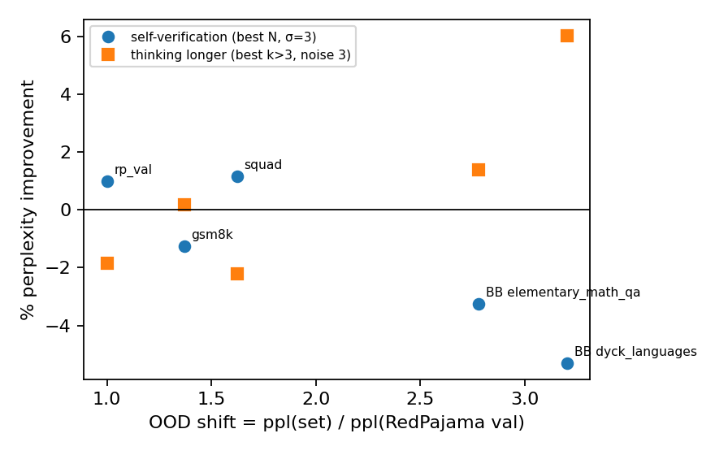

# OOD evaluation — does EBT-S2 thinking help out of distribution?

> [!summary] TL;DR
> - **Self-verification does not help out of distribution; it hurts more the further out we go.** Picking the lowest-energy candidate never beats a random pick by the pre-registered 0.02 nats on any of the four OOD sets. On GSM8K, BB Elementary Math QA and BB Dyck it is harmful at every N, and the harm grows with OOD shift (Spearman −0.70 over 5 points). That is the opposite of the paper's Fig. 7.
> - **Thinking longer does not help either.** Without noise, the trained k = 3 is best or tied on every set. With Langevin noise 3, extra steps recover part of what the noise costs: up to 6% on Dyck, the only set past the 0.02-nat threshold (1/4). Even the best noisy run stays 0.03–0.07 nats worse than plain k = 3 without noise.
> - **T++ beats S2 on every OOD set,** and S2's relative deficit is largest on the two BigBench sets (ppl ratio 1.41–1.50 vs 1.19 in distribution). The paper's Table 3 reports the reverse on three of four sets, with models trained on about 8× more data.

## 1. Setup

| Item | Value |
|---|---|
| Models | S2 `s2-b64-16m` and T++ `tpp-b64-16m`, both at step 250k (16M sequences, batch 64); see [scale-16m report](../../report/report.md) |
| OOD sets | GSM8K test, SQuAD v2 validation (answerable only), BigBench Elementary Math QA validation, BigBench Dyck Languages validation (paper §4.1.3 / Table 3) |
| Text and scoring | Repo loaders' `pretrain` format `Question: …\nAnswer: …`, GPT-NeoX, truncated at 257 tokens; **all** non-pad tokens scored (as `get_ppl`); answer tokens only as a secondary metric |
| Sample | ≤ 1,024 sequences per set, `eval_subset_indices` seed 0 (Dyck has only 200) |
| RQ1 (self-verification) | Q2 at σ = 3: 32 candidates from S2's own inference, lowest final energy vs random pick |
| RQ2 (thinking longer) | Q3 Part A: CE after k = 1…32 steps at noise 0 and 3, trained k = 3 |
| In-distribution point | Existing 250k RedPajama-val runs (Q2: 1,024 sequences; Q3: 256 sequences) |

Data ([data_stats.json](data_stats.json)):

| Set | Items | Median tokens | Truncated | Answer cut off | Scored tokens |
|---|---|---|---|---|---|
| GSM8K | 1,319 | 153 | 5.7% | 0% | 159,980 |
| SQuAD | 5,928 | 172 | 13.3% | 12.7% | 181,426 |
| BB Elementary Math QA | 7,629 | 76 | 0.04% | 0.04% | 81,451 |
| BB Dyck Languages | 200 | 44 | 0% | 0% | 10,818 |

> [!note] Deviation: data source
> `datasets` 3.0.0 can no longer parse the Hub's metadata for these repos (feature type `List` from `datasets` 4.x), so the repo loaders' `__init__` fails. The same split files are read as parquet at pinned revisions (`ood_data.PARQUET`). They are formatted by the loaders' own `__getitem__`, so the text is unchanged.

## 2. Results

All numbers from [result.md](result.md).

### 2.1 Perplexity and OOD shift

| Set | T++ ppl | S2 ppl (σ = 3, 1 sample) | S2 / T++ | OOD shift (S2 ppl / S2 rp_val ppl) |
|---|---|---|---|---|
| RedPajama val | 33.94 | 40.50 | 1.19 | 1.00 |
| GSM8K | 48.68 | 55.44 | 1.14 | 1.37 |
| SQuAD | 54.38 | 65.69 | 1.21 | 1.62 |
| BB Elementary Math QA | 75.13 | 112.65 | 1.50 | 2.78 |
| BB Dyck Languages | 92.30 | 129.72 | 1.41 | 3.20 |

### 2.2 RQ1 — self-verification

CE(lowest-energy pick) − CE(random pick), σ = 3; negative = energy helps:

| Set | N=2 | 4 | 8 | 16 | 32 | best % ppl improvement |
|---|---|---|---|---|---|---|
| RedPajama val | −0.010 | +0.006 | +0.034 | +0.066 | +0.099 | +1.0% (N=2) |
| GSM8K | +0.013 | +0.049 | +0.094 | +0.140 | +0.184 | −1.3% (N=2) |
| SQuAD | −0.012 | +0.006 | +0.038 | +0.077 | +0.115 | +1.1% (N=2) |
| BB Elementary Math QA | +0.032 | +0.081 | +0.133 | +0.179 | +0.221 | −3.2% (N=2) |
| BB Dyck Languages | +0.052 | +0.118 | +0.185 | +0.255 | +0.316 | −5.3% (N=2) |

- SQuAD behaves like the in-distribution set: a ≈ 1% gain at N = 2, then growing harm.
- On the other three sets, energy selection is harmful already at N = 2. The harm at N = 32 is largest on the two BigBench sets (+0.22, +0.32 vs +0.10 in distribution); it is not monotone in shift (GSM8K +0.18 > SQuAD +0.12).
- Answer tokens only: BoN-32 is harmful on all four sets (+0.12 to +0.64 nats).

### 2.3 RQ2 — thinking longer

| Set | noise | CE k=3 | best k > 3 (Δ vs k=3) | CE k=32 | best noisy run − noise-0 k=3 |
|---|---|---|---|---|---|
| RedPajama val | 0 / 3 | 3.724 / 3.735 | k=5: +0.032 / k=5: +0.018 | 3.817 / 3.772 | +0.029 |
| GSM8K | 0 / 3 | 3.969 / 4.017 | +0.025 / k=5: −0.002 | 4.043 / 4.023 | +0.046 |
| SQuAD | 0 / 3 | 4.181 / 4.185 | +0.035 / +0.022 | 4.307 / 4.230 | +0.027 |
| BB Elementary Math QA | 0 / 3 | 4.648 / 4.728 | +0.030 / k=7: −0.014 | 4.756 / 4.723 | +0.066 |
| BB Dyck Languages | 0 / 3 | 4.747 / 4.868 | k=17: −0.003 / k=5: −0.062 | 4.853 / 4.821 | +0.059 |

The last column is the best noise-3 CE at any k > 3, minus the noise-0 CE at k = 3.

- **Without noise** (the cleaner test of "more steps than trained"), k = 3 is best everywhere except Dyck, where k = 17 is 0.003 nats lower. The even/odd oscillation seen in distribution is present on every set (k = 4, 6 worse than k = 5).
- **With noise 3,** extra steps help more as shift grows: Dyck −0.062 (6.0%), Elementary Math −0.014. But noise 3 itself raises the k = 3 CE most on those sets (+0.12 on Dyck, +0.08 on Elementary Math). No noisy run beats noise-free inference at the trained step count (last column: all positive).
- Answer tokens only, noise 0: thinking longer helps on Dyck (7.294 → 7.184 on 398 tokens) and hurts or ties on the other three sets.

### 2.4 Gains vs OOD shift (Fig. 7 analogue)



- Self-verification (best N): Spearman(shift, % improvement) = **−0.70**. The gain shrinks into harm as data gets more OOD.
- Thinking longer (best k > 3, noise 3): Spearman = **+0.70**. This matches the paper's direction, but per §2.3 it measures recovery from the noise's own cost, not a gain over the default inference.

## 3. Verdicts on the pre-registered claims

| Claim | Threshold | Result | Verdict |
|---|---|---|---|
| RQ1: self-verification helps OOD | Best N ∈ {2..32} beats random by > 0.02 nats on ≥ 3/4 sets | 0/4 (best: SQuAD −0.012 at N = 2) | **Not supported** |
| RQ2: thinking longer helps OOD | min over k > 3 beats k = 3 by > 0.02 nats, at noise 0 or 3, on ≥ 3/4 sets | 1/4 (Dyck at noise 3, −0.062) | **Not supported** |
| Fig. 7: gains grow with shift | Spearman > 0 over 5 points, for both gains | RQ1 −0.70; RQ2 (noise 3) +0.70 | **Not supported for self-verification** (reversed); RQ2 positive but explained by noise recovery (§2.3). Descriptive only: 5 points, one seed |

## 4. Interpretation

- The in-distribution findings carry over and get stronger OOD. The energy ranks candidates mostly by sharpness ([scale-16m report](../../report/report.md) §2.5). On sets where the model is less certain, the sharper candidate is more often wrong, so selecting by energy costs more. This is an interpretation consistent with the data; we did not test it separately here.
- Thinking longer at noise 0 behaves as in distribution: the loop is best at the trained step count (Q3 fixed-point analysis). The Dyck noise-0 exception (k = 17, −0.003 nats on 10.8K tokens) is within what one would expect from noise on the smallest set.
- The paper's OOD gains (up to 29% in Fig. 6a; 18.7% on Dyck in Table 2) come from models trained with batch 128 for 1M steps, and the paper reports that thinking gains grow with training (Fig. 6b). Our 16M-sequence models are 8× short of that, so a negative here is weaker evidence against the paper than a negative at its scale would be.

> [!warning] Limitations
> - **One seed, one checkpoint pair.** No variance estimate.
> - **Scale:** 16M sequences at batch 64 vs the paper's 128M at batch 128.
> - **Scored tokens:** the paper does not state which tokens it scores; all-token scoring follows the repo's `get_ppl`. Question tokens dominate the count (answer tokens are 61% of GSM8K, 2–4% of the other sets).
> - **SQuAD truncation:** 12.7% of SQuAD items lose their answer to the 256-token context.
> - **Dyck is small:** 200 items, 10,818 scored tokens, 398 answer tokens.
> - **Unequal samples:** in-distribution Q3 used 256 sequences; OOD Q3 used 1,024 (Dyck 200).
> - **Not measured:** the paper's "max thinking" (more steps and best-of-N combined), and S2 at other checkpoints.

## 5. Reproduction

```bash
cd refs/EBT/experiments/scale_to_16m_sequences
export HF_HOME=/mnt/data/quangnx/huggingface TMPDIR=/mnt/data/quangnx/tmp
PY=/mnt/data/conda-envs/quangnx/ebt312/bin/python
PYTHONPATH=$PWD/../..:$PWD/../thinking_study/common $PY ood/prepare_data.py --out ood/report/data_stats.json
GPU_ID=6 DATASETS="gsm8k bigbench_dyck_languages" bash ood/run_ood.sh            # ~16 min
GPU_ID=7 DATASETS="squad bigbench_elementary_math_qa" bash ood/run_ood.sh        # ~29 min
$PY ood/collect_ood.py                                                        # report/result.md, figures/ood_shift.png
```
