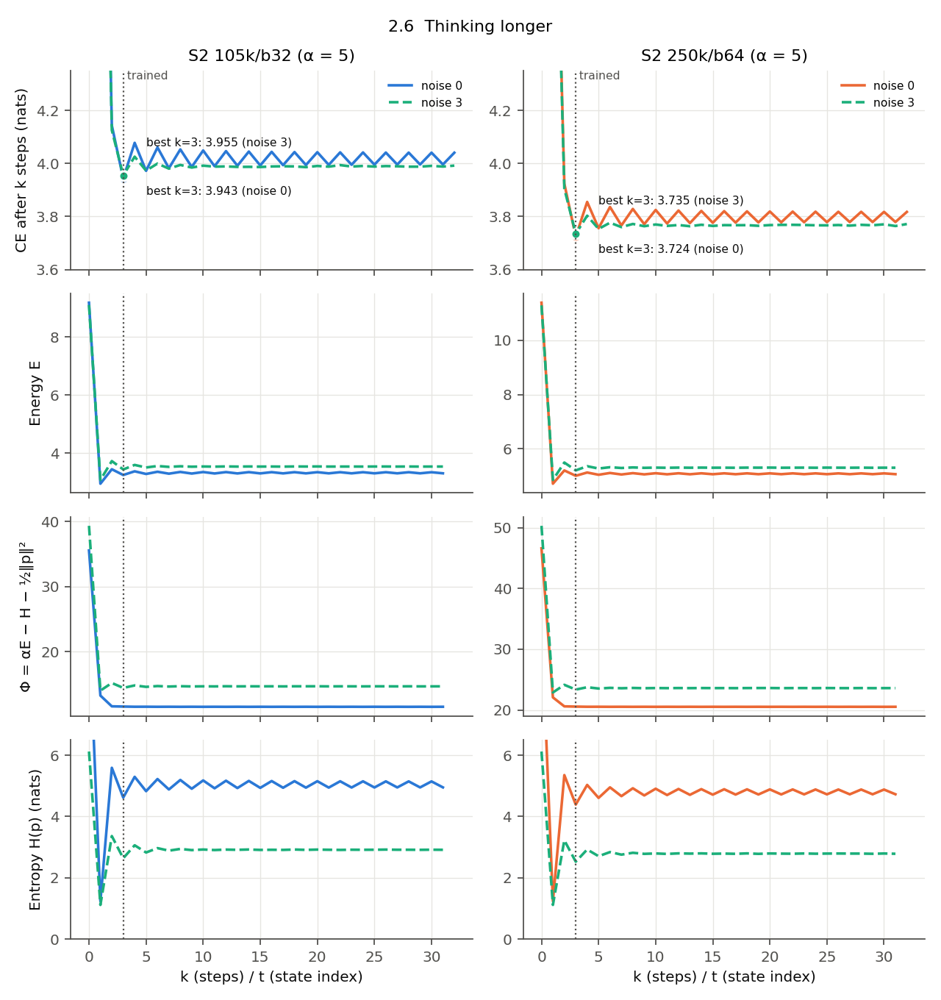
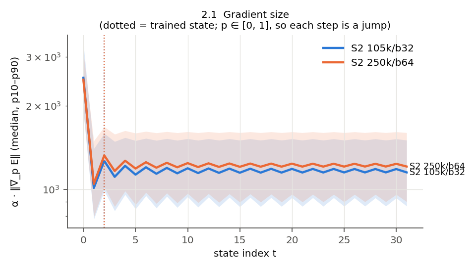
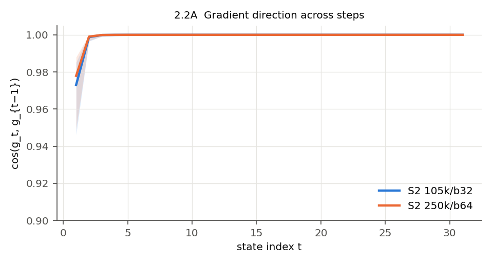
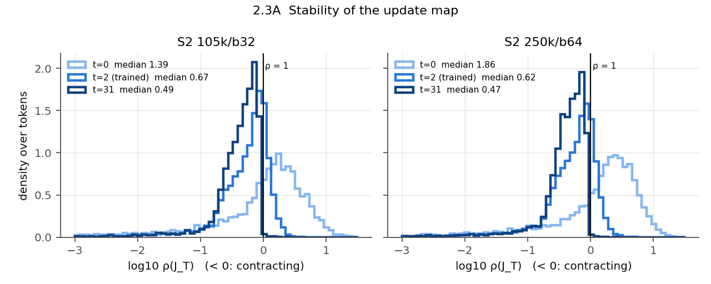
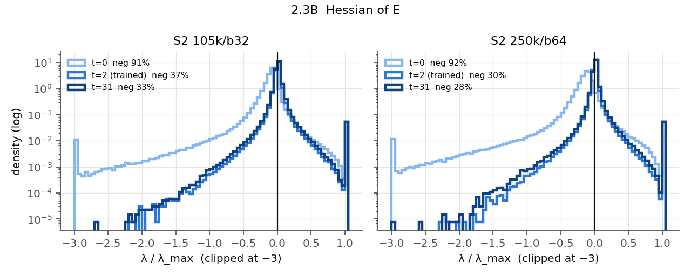
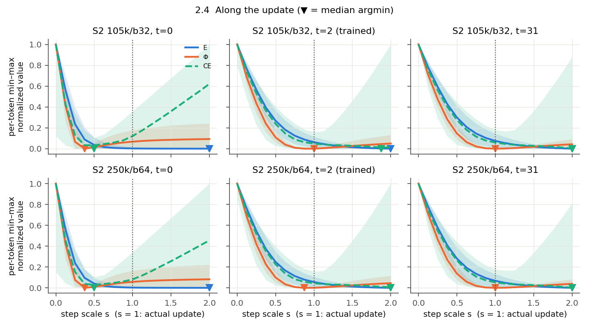
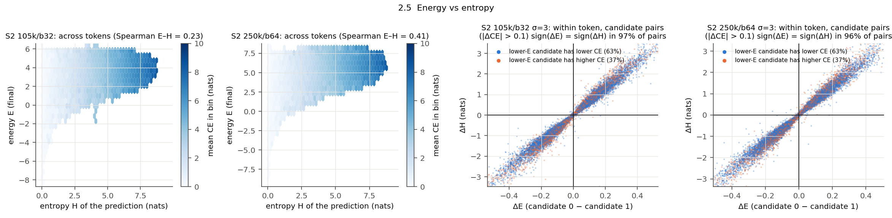

# Scale to 16M sequences — does EBT-S2 move toward the paper?

> [!summary] TL;DR
> - **The loss gap shrinks with data, as the paper predicts.** At 16M sequences (batch 64, 250k steps) the S2 − Transformer++ validation gap is **+0.179 nats**, vs +0.247 at 3.36M (batch 32). It falls steadily along the run (0.306 at 25k → 0.179 at 250k) and lands near the log-linear interpolation toward the paper (≈ 0.17).
> - **The verifier does not get better than at the small point.** BoN-32 efficiency at σ = 3 is −0.21 (vs −0.20) and pairwise consistency is 0.628 (vs 0.623). Within the 16M run both improve monotonically (−0.43 → −0.21, 0.559 → 0.628), but they only climb back to the 3.36M/b32 level. Lowest-energy selection is still harmful from N = 4 on, and the energy still ranks by sharpness (97.5% of pairs): as a selector, entropy alone does as well as E (§2.5).
> - **Thinking longer still does not help.** The best step count is still the trained one (k = 3), and the penalty for 32 steps is essentially unchanged (+0.093 vs +0.097 nats). The Q3 mechanism findings carry over to 16M. The loss gap closes without selection by energy or extra inference steps getting any better.

## 1. Setup

| Item | 3.36M point (existing) | 16M point (this experiment) |
|---|---|---|
| Runs | `baseline-xxs-scaling-105k`, `ebt-s2-xxs-scaling-105k` ([reproduction](../../reproduce_xxs_scaling/report/report.md)) | `tpp-b64-16m`, `s2-b64-16m` |
| Steps × global batch | 105k × 32 = 3.36M sequences | 250k × 64 = 16M sequences, DDP on 2 × H100 NVL |
| LR, schedule, model | 0.0012, warm-up 10k, cosine; xxs (D = 384) | Same |
| Training data | 3.4M-doc RedPajama subset | 16.1M-doc superset whose first 3.4M docs are the old build (verified row by row) |
| Validation set | 33,320 sequences | The same 33,320 sequences (`--fixed_val_indices`) |
| Q2 / Q3 eval | Thinking-study scripts, same eval subsets (1,024 seqs for Q2; 256 + 32 for Q3) | Same |

Plan and pre-registered claims: [IMPLEMENTATION_PLAN](../IMPLEMENTATION_PLAN.md) §0. Generated tables: [result.md](result.md). Background for the Q2/Q3 metrics: [[SUMMARIZED_FINDINGS]].

> [!note] S2 run interruption
> - The S2 run crashed at step 50,976: the shared root filesystem filled up while the log was being written.
> - It resumed from the step-50k checkpoint with `--resume_data_offset_steps 50000`. This reorders the train set so the sampler continues the original shuffled order where it stopped, so S2 still sees 16M distinct sequences once each.
> - On restart, Lightning re-validated the step-50k weights and logged 4.1304. The original value was 4.0906, and offline recomputation of the same weights gives 4.0900 / 4.0903 (two seeds). The re-validation value is not used. Its likely cause (from reading the Lightning 2.4 source, not confirmed by a run): the checkpoint was saved at validation end, so on restart the validation loop's progress counters come back as complete, and the re-validation covers only about one batch per rank. The 75k value (4.0022) and the train loss continue the pre-crash trend.

## 2. Results

### 2.1 Validation loss and gap

| Step | 25k | 50k | 75k | 100k | 125k | 150k | 175k | 200k | 225k | 250k |
|---|---|---|---|---|---|---|---|---|---|---|
| Sequences seen | 1.6M | 3.2M | 4.8M | 6.4M | 8.0M | 9.6M | 11.2M | 12.8M | 14.4M | 16M |
| T++ | 3.9715 | 3.8253 | 3.7575 | 3.7109 | 3.6713 | 3.6351 | 3.6017 | 3.5713 | 3.5509 | **3.5400** |
| S2 | 4.2776 | 4.0906 | 4.0022 | 3.9382 | 3.8893 | 3.8412 | 3.7942 | 3.7563 | 3.7386 | **3.7191** |
| Gap S2 − T++ | +0.306 | +0.265 | +0.245 | +0.227 | +0.218 | +0.206 | +0.193 | +0.185 | +0.188 | **+0.179** |

- At the 3.36M/b32 point the gap was +0.247 (T++ 3.6964, S2 3.9431).
- At 3.2M sequences the batch-64 run is behind the batch-32 run for both models (T++ 3.825 vs 3.696; S2 4.091 vs 3.943). Two things differ at that point: the b64 run has taken half as many steps, and it is early in its cosine schedule (LR 1.13e-3 at 50k), while the b32 run ends fully annealed (LR 1.2e-4). The gap there (+0.265) is close to the batch-32 gap (+0.247), so batch size and schedule phase together shift both models by similar amounts.

### 2.2 Q2 — verifier quality (S2, σ = 3 unless noted)

| Checkpoint | Single-sample CE | BoN-32 CE | Oracle-32 CE | BoN-32 efficiency | Consistency (\|ΔCE\| > 0.1) |
|---|---|---|---|---|---|
| 3.36M / b32 (105k) | 3.9224 | 4.0232 | 3.4138 | −0.20 | 0.623 |
| 16M run, 50k | 4.0677 | – | – | −0.43 | 0.559 |
| 16M run, 100k | 3.9163 | – | – | −0.33 | 0.584 |
| 16M run, 150k | 3.8189 | – | – | −0.32 | 0.591 |
| 16M run, 200k | 3.7382 | – | – | −0.26 | 0.610 |
| **16M run, 250k** | 3.7013 | 3.7994 | 3.2207 | **−0.21** | **0.628** |

Change in CE from picking the lowest energy among N candidates, relative to a random pick:

| N | 2 | 4 | 8 | 16 | 32 |
|---|---|---|---|---|---|
| 3.36M / b32 | −0.010 | +0.006 | +0.035 | +0.068 | +0.102 |
| 16M, 250k | −0.010 | +0.006 | +0.034 | +0.066 | +0.099 |

| Metric (S2, σ = 3) | 3.36M / b32 | 16M |
|---|---|---|
| Lower E ⇒ lower entropy (pairs) | 0.982 | 0.975 |
| `e_last_logged` consistency (\|ΔCE\| > 0.1) | 0.389 | 0.384 |
| AUROC(energy → top-1 error) / AUROC(entropy → top-1 error) | 0.628 / 0.806 | 0.670 / 0.815 |
| Spearman(energy, CE) across tokens | 0.233 | 0.353 |
| one-hot(T++ argmax) has the lowest energy (of 7 candidates) | 44.2% | 43.1% |
| one-hot(target) has the lowest energy | 30.3% | 31.3% |

The off-trajectory candidates come from a different T++ at each point (105k/b32 vs 250k/b64), so the last two rows compare different candidate sets.

- The BoN curve at 16M is almost identical to the 3.36M one: a tiny gain at N = 2, then growing harm.
- The energy is a somewhat better *uncertainty* signal across tokens at 16M (AUROC 0.63 → 0.67, Spearman 0.23 → 0.35), but it is still well below predictive entropy. It is not a better *selector* among candidates of one token.
- Without noise (σ = 0) the 32 candidates are still near-identical (CE std 0.0014 nats), so BoN cannot help there (efficiency +0.13 on a 0.003-nat oracle range).
- At matched validation loss the small-batch model verifies better. S2 105k/b32 (3.943) and S2 100k/b64 (3.938) have nearly the same loss, but efficiency is −0.20 vs −0.33 and consistency 0.623 vs 0.584. This is one comparison with one seed per run. It is an observation, not an explanation. Candidate causes: batch size, step count (105k vs 100k), schedule phase (105k/b32 is fully annealed at LR 1.2e-4; 100k/b64 is mid-schedule at LR 8.7e-4), or seed noise. Both fully annealed end points (105k/b32 and 250k/b64) show nearly the same verifier quality, so "the verifier tracks how annealed the model is" fits the data as well as "the verifier improves with training".

### 2.3 Q3 — thinking longer and the landscape (S2, step 250k)

Mean CE after k steps (noise 0; 256 sequences):

| k | 1 | 2 | 3 | 4 | 5 | 6 | 8 | 16 | 31 | 32 |
|---|---|---|---|---|---|---|---|---|---|---|
| 3.36M / b32 | 6.282 | 4.143 | **3.943** | 4.078 | 3.972 | 4.060 | 4.053 | 4.044 | 3.996 | 4.041 |
| 16M | 5.581 | 3.924 | **3.724** | 3.855 | 3.756 | 3.836 | 3.829 | 3.820 | 3.779 | 3.817 |

- Penalty of k = 32 vs the trained k = 3: +0.097 → +0.093 nats (noise 0; 0.0971 → 0.0930 unrounded); +0.037 → +0.037 (noise 3).
- The even/odd oscillation persists at 16M: odd k settles about 0.04 nats lower than even k (k = 31: +0.055; k = 32: +0.093).

| Metric | 3.36M / b32 (t = 0 / 2 / 31) | 16M (t = 0 / 2 / 31) |
|---|---|---|
| Median spectral radius ρ of the update Jacobian | 1.39 / 0.67 / 0.49 | 1.86 / 0.62 / 0.47 |
| Share of negative Hessian eigenvalues | 91% / 37% / 33% | 92% / 30% / 28% |
| Tokens locally convex | 0% / 0% / 0% | 0% / 0% / 0% |
| λ_max / median\|λ\| | 13 / 75 / 56 | 8.5 / 104 / 76 |
| Participation ratio of ∇_eE (of 384) | 29.8 / 20.1 / 20.5 | 37.4 / 24.1 / 24.9 |
| Line argmin s along the update: CE / E / Φ (t = 2) | 1.625 / 2.0 / 1.0 | 1.625 / 2.0 / 0.875 |
| Median steps to converge (TV < 0.01, noise 0) | 7 | 7 |
| Spearman(steps to converge, entropy) | 0.81 | 0.82 |

- **The mechanism findings hold at 16M.** E is still nowhere locally convex, the loop still contracts after the first steps, the update is still close to line-optimal for Φ rather than for E, and adaptive compute still tracks entropy.
- Several quantities moved:
  - The Φ line-minimizer at the trained state is s = 0.875, one grid step (0.125) below 1.0. It is still 1.0 at t = 31.
  - The share of negative Hessian eigenvalues fell (t = 2: 37% → 30%; t = 31: 33% → 28%), although no token is locally convex.
  - The effective dimension grew (participation ratio 20 → 24 at the trained state, 30 → 37 at t = 0) and the curvature became more anisotropic (75 → 104).
  - At the initial noise (t = 0) the map expands more (median ρ 1.39 → 1.86).

### 2.4 Q3 — extra landscape metrics and figures (S2 105k/b32 vs 250k/b64)

From `analyze_q3_extra.py` (offline, same Q3 arrays as §2.3; medians over tokens unless noted):

| Metric | 3.36M / b32 | 16M |
|---|---|---|
| α · median ‖∇_pE‖ at the trained state (noise 0) | 1266 | 1324 |
| Median ratio ‖∇_pE‖ at t = 31 / trained state | 0.94 | 0.94 |
| Tokens not converged at t = 31 (TV ≥ 0.01, noise 0) | 17.7% | 14.4% |
| Tokens in a 2-cycle at t = 31 (noise 0) | 16.2% | 13.2% |
| Mean \|ΔE\| per step after step 10 (noise 0) | 0.043 | 0.034 |
| t = 0: strongly negative eigenvalues (< −0.1 λ_max), of 384 | 102 | 283 |
| t = 0: share of tokens with \|λ_min\| > λ_max | 82% | 93% |
| t = 2: share of flat eigenvalues (\|λ\| < 0.01 max\|λ\|) | 39% | 51% |
| t = 2: share of tokens with negative Hessian trace | 6.9% | 2.5% |
| Share of tokens where E is convex along the update line, t = 2 / t = 31 | 66% / 67% | 53% / 57% |
| Share of tokens where Φ is convex along the update line, t = 2 / t = 31 | 0.6% / 3.9% | 0.5% / 2.8% |
| Spearman(E, H) across tokens (Q2 σ = 0, candidate 0) | 0.23 | 0.41 |

- **The landscape shape is the same.** Every figure below shows the same picture at both points: no vanishing or exploding gradient, a near-constant gradient direction after t = 1, contraction after the first steps, the Φ line-minimizer near s = 1, and the even/odd alternation.
- **What moved.**
  - The initial noise sits in a more concave region: 283 vs 102 strongly negative directions, and ρ 1.86 vs 1.39.
  - At the trained state the Hessian is flatter: more flat eigenvalues, fewer tokens with a negative trace.
  - Fewer tokens end in a 2-cycle (16% → 13%).
  - Across tokens, E is more correlated with entropy (0.23 → 0.41).
- Along the update line, E is convex for fewer tokens (66% → 53% at t = 2). This sits alongside the drop in negative Hessian eigenvalues (§2.3), so the two curvature views do not agree on a single direction of change.

Figures (`plot_q3.py --set scale16m`; blue = 3.36M/b32, orange = 16M):









### 2.5 Is the energy only an entropy score among candidates?

Within one token, compare candidates 0 and 1 of the Q2 σ = 3 runs (pairs with |ΔCE| > 0.1). "Right" means the candidate with the lower score also has the lower CE (`entropy_vs_energy.py`):

| Metric | 3.36M / b32 | 16M |
|---|---|---|
| Pairs | 154,969 | 149,426 |
| Lower E is right | 62.3% | 62.8% |
| Lower entropy H is right | 62.2% | 62.6% |
| R² of a linear fit ΔE ~ ΔH | 0.976 | 0.976 |
| Residual of E after the fit on H is right | 56.7% | 56.6% |
| BoN-32 CE, selecting by E / by H | 4.0232 / 4.0282 | 3.7994 / 3.8042 |
| CE of candidate 0 (no selection) / oracle-32 | 3.9224 / 3.4138 | 3.7013 / 3.2207 |

- **As a selector, E is almost exactly a linear function of the prediction's entropy.** Entropy alone ranks pairs as well as E and gives almost the same BoN-32 CE. Both are worse than no selection.
- **E is not only entropy.** The part of ΔE not explained by ΔH still ranks 56.7% of pairs correctly, above the 50% of a random pick. The energy carries some candidate-quality signal beyond sharpness, but sharpness dominates it.
- The 0.976 R² is partly a product of the candidate set: σ = 3 noise yields candidates that differ mostly in sharpness. Across tokens, E and H are much less related (Spearman 0.23 / 0.41, §2.4).
- **This concerns the energy's scalar value, not its gradient.** H(p) does not depend on the context, so it cannot replace ∇E as the update direction: the loop's move from noise to a prediction (CE 5.58 at k = 1 → 3.72 at k = 3) needs the context, which only E sees.
- Not tested here: whether the residual is a usable selector (BoN by E − βH), and which other per-candidate features (‖p‖², max probability, token frequency) the residual tracks.

## 3. Verdicts on the pre-registered claims

| Claim (plan §0) | Threshold | Result | Verdict |
|---|---|---|---|
| Gap shrinks with data | gap(16M, b64) < 0.247 − 0.03 = 0.217 | +0.179 (−0.068 nats); monotone along the run except one +0.003 bump at 225k | **Supported** |
| Verifier improves with training | BoN-32 efficiency and consistency increase from the 105k/b32 point (−0.20; 0.623) **and** along the 16M run | vs 105k/b32: −0.21 and 0.628 (efficiency −0.01, consistency +0.005). Along the run: −0.43 → −0.21 and 0.559 → 0.628, both monotone | **Not supported** as pre-registered: efficiency did not increase from the 105k/b32 point. The along-run rise is confounded with LR annealing (§2.2); the verifier stays net-harmful |
| Thinking helps more | k = 32 penalty shrinks, or best k grows | Penalty 0.0971 → 0.0930 nats (−0.004); best k = 3 at both points | **Technically met, judged as no change.** The rule has no margin and the penalty did shrink. We treat a 0.004-nat change as no change: it is small next to the other effects here, and seed variance is unmeasured. This is a post-hoc judgement, not part of the pre-registration |

The plan predicted ≈ 0.17 nats at 16M by log-linear interpolation toward the paper's +0.064 at 128M. The measured +0.179 is close to that guide. So the loss result is consistent with the paper's scaling direction at this scale.

## 4. Interpretation

- **Loss and "thinking" decouple.** More data closes S2's loss gap to T++, but the two System-2 uses of the energy do not improve beyond the 3.36M/b32 point:
  - selection by energy among candidates;
  - gains from running more inference steps.
- Other properties did move: the energy is a better across-token uncertainty signal (AUROC 0.63 → 0.67), and E has fewer negative-curvature directions, though it is still nowhere locally convex.
- Descriptively, the gap closes at the trained step count without best-of-N or extra steps. That is how validation loss is measured, so this statement describes the setup rather than identifying a mechanism.
- This fits the structural findings in [[SUMMARIZED_FINDINGS]] §2.1: the loss never trains the energy to rank candidates, and the code's loop is a fixed point of Φ. Neither depends on data scale, so there is no reason to expect them to change with more data alone. This is an interpretation consistent with the data, not a tested causal claim.
- Within the 16M run, verification improves along the run, in the direction of the paper's Fig. B.1. The data cannot separate "more training" from LR annealing or from batch size vs steps as the driver (§2.2).

> [!warning] Limitations
> - **One seed per point.** Seed variance is not measured; differences of ≈ 0.01 in efficiency, ≈ 0.005 in consistency, or ≈ 0.005 nats in the thinking penalty are treated here as no change. That threshold is a judgement, not a measured noise level.
> - **Batch size differs between the two points** (32 vs 64). At a fixed number of sequences, the smaller batch takes twice the steps. **Schedule phase differs too:** each run anneals its cosine LR to its own end, so intermediate b64 checkpoints are compared with a fully annealed b32 checkpoint. Both effects mix in the 3.2M comparison (§2.1) and in the Q2 verifier metrics (§2.2). The within-run curves at b64 are the cleaner comparison for the loss gap, but they too are confounded with LR annealing.
> - **xxs only** (D = 384). The paper's scaling claims concern larger models too.
> - **Batch 64 vs the paper's 128**, and data still 8× below the paper's 128M sequences.
> - **The S2 run was resumed once at 50k** (§1). Optimizer, scheduler and data order were restored; the in-memory MCMC replay buffer (not checkpointed; 192 samples) restarted empty.
> - Q2/Q3 use the same eval subsets as the thinking study (228K tokens for Q2; 55,825 and 6,949 tokens for Q3), in-distribution only.

## 5. Reproduction

```bash
cd refs/EBT/experiments/scale_to_16m_sequences
GPU_IDS=4,5 bash run_all.sh                                     # T++ then S2, ~4 h + ~23 h on 2 × H100 NVL
# after a crash, resume S2 with N = global step of last.ckpt:
GPU_IDS=4,5 bash run_s2.sh --run_name s2-b64-16m --max_steps 250000 --val_check_interval 25000 \
  --resume_training_ckpt <abs path>/last.ckpt --resume_data_offset_steps N
GPU_ID=4 PART=final bash run_eval.sh                            # Q2 σ=3/0 and Q3 at 250k, ~20 min
GPU_ID=5 PART=curve bash run_eval.sh                            # Q2 σ=3 at 50k-200k, ~25 min
PY=/mnt/data/conda-envs/quangnx/ebt312/bin/python
$PY collect.py                                                  # writes report/result.md
$PY ../thinking_study/q3_energy_landscape/analyze_q3_extra.py results/q3_energy_landscape/s2_b64_16m_step250000
$PY ../thinking_study/q3_energy_landscape/plot_q3.py --set scale16m   # report/figures/*.png (§2.4)
$PY entropy_vs_energy.py ../thinking_study/q2_verifier_quality/results/s2_step105000_noise3 \
  results/q2_verifier_quality/s2_b64_16m_step250000_noise3      # §2.5
```
