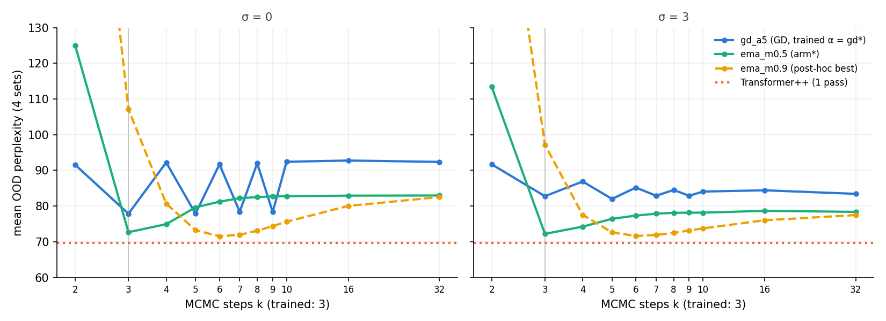
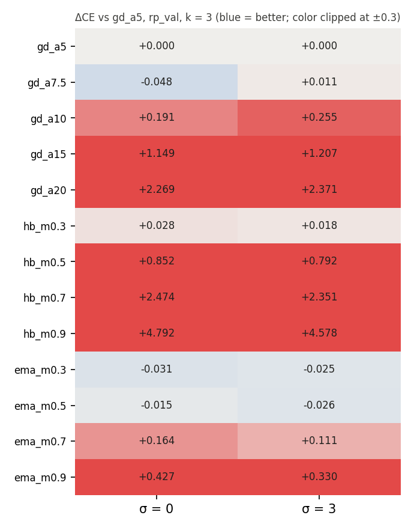
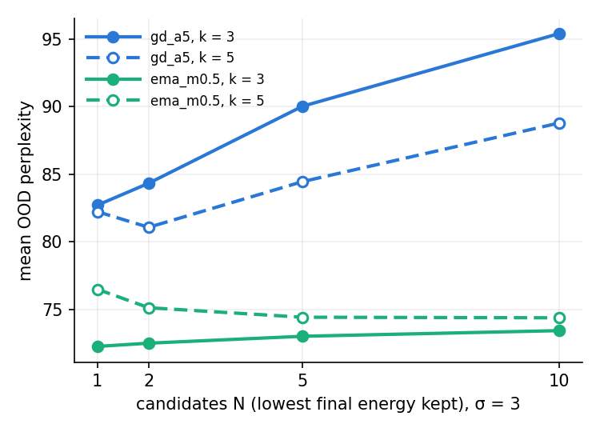
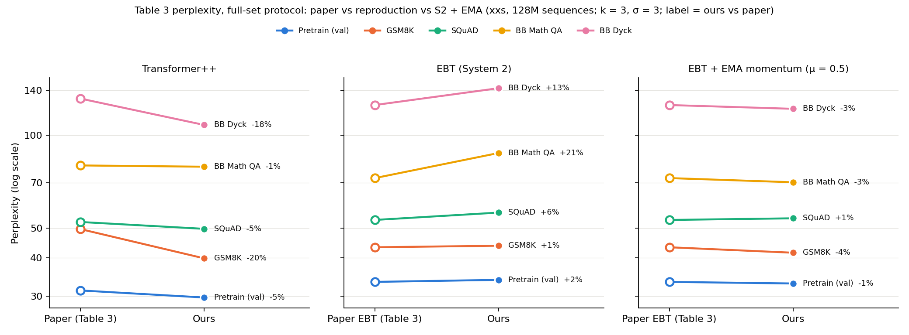

# Energy momentum — training-free momentum in EBT inference

> [!summary] TL;DR
> - **Bias-corrected EMA momentum (μ = 0.5) is a free, sizeable win at the trained step count.** On the final `s2_paper` checkpoint, with the same 3 forward passes, mean OOD perplexity falls from **82.76 to 72.21 (−12.7%)**. The paired 95% CI is below zero on all 5 sets, from −2.6% ppl in distribution to −19.8% on BB Math QA. Larger GD steps do not explain it (the best GD configuration over every α ≥ 5 and k reaches only 78.0). In the [step-size follow-up](../../step_size_decay/report/report.md), smaller constant α (2.5, 3.5) and 5 decaying schedules are all worse than α = 5 at k = 3 (best 84.4). S2 now beats T++ on BB Math QA (70.9 vs 80.3), though it still trails on the 4-set mean (72.2 vs 69.7). Under the full-set Table 3 protocol (§2.6), the gain holds on every set (paired CIs exclude 0), and S2 + EMA (71.9 OOD mean) is at or below the paper's EBT on 4 of 5 sets.
> - **It coincides with removing the GD loop's even/odd oscillation, not with making longer thinking pay off.** Plain GD leaves 29.6% of rp_val tokens in a 2-cycle at t = 31; every EMA and heavy-ball arm leaves ≈ 0%. For the selected arm, more steps still hurt (k = 5 is 5.8% worse than k = 3, M3 not supported). Larger μ moves the optimum to k = 4–7 instead: `ema_m0.9` at k = 6 gives 71.6, post hoc.
> - **Self-verification remains unhelpful at the trained length (M5 not supported), but it is no longer harmful.** BoN-10 vs 1 sample is −1.6% with EMA vs −15.3% with GD. At k = 5 with EMA, BoN helps on all 5 sets (+0.8% to +5.1%; post hoc, no CI, Dyck's +0.8% may be noise). Heavy-ball with μ ≥ 0.5 degrades badly (μ = 0.9 diverges), because its effective step α/(1−μ) is too large. Phase 3 (retraining) is **not triggered**, since M1 holds.

## 1. Setup

| Item | Value |
|---|---|
| Model | `s2_paper` step 1,000,000 (xxs, 128M sequences; [[report\|paper-scale report]]) — no retraining |
| Loop | `p_t = softmax(z_t + η_t)`, `g_t = ∂E/∂p`, `z_{t+1} = p_t − α u_t`; `u_t` per rule (§0.1 of the [[IMPLEMENTATION_PLAN]]) |
| Rules | `gd`: `u = g`; `hb`: `u = Σ μ^{t−i} g_i`; `ema`: `u = Σ μ^{t−i} g_i / Σ μ^{t−i}` (bias-corrected; equals GD for a constant gradient) |
| Arms | `gd_a{5, 7.5, 10, 15, 20}` (step-size controls), `hb_m{0.3, 0.5, 0.7, 0.9}`, `ema_m{0.3, 0.5, 0.7, 0.9}` (α = 5) |
| Data | rp_val + GSM8K, SQuAD, BB Elementary Math QA, BB Dyck. The same 1,024 sequences as `../results/q3` and `../results/q2` |
| Noise | σ ∈ {0, 3}; every arm sees identical noise draws (common random numbers), so all comparisons are paired |
| Selection | `arm*`, `gd*` and `k*` were chosen on rp_val CE at k = 3, σ = 3 **before** reading OOD: `arm* = ema_m0.5`, `gd* = gd_a5`, `k* = 5` |
| Compute | 65 single-trajectory runs (32 steps) + 20 BoN runs (10 candidates), GPUs 0, 2, 3, ≈ 1.5 h wall-clock |

**Reproduction check:** `gd_a5` reproduces the earlier pipeline exactly.
- The per-token arrays are bit-identical to `../results/q3` (max abs difference 0.0; the unit test checks 1e-5).
- The mean OOD ppl matches `../report/result.md` at k = 2 / 3 (91.68 / 82.76).
- The BoN-2 / 5 / 10 values match the paper-scale Fig. 6a analogue (84.33 / 90.03 / 95.40).

## 2. Results

### 2.1 Pre-registered claims

| # | Claim | Result | Supported if | Verdict |
|---|---|---|---|---|
| M1 | Momentum helps at the trained length | 82.76 → 72.21 (+12.7%); CI < 0 on 4/4 OOD sets | > 2% and CI < 0 on ≥ 3/4 | **Supported** |
| M2 | The gain is not explained by a larger step | `gd*` = `gd_a5` 82.76 vs 72.21 (+12.7%) | > 1% | **Supported** |
| M3 | Momentum makes thinking longer useful | k = 3 72.21 → k\* = 5 76.42 (−5.8%) | > 2% | **Not supported** |
| M4 | Momentum damps late-loop 2-cycles | 0.0% (GD 29.6%) | < 15% | **Supported** |
| M5 | Momentum makes self-verification useful | 1 sample 72.26 → BoN-10 73.43 (−1.6%) | > 0 | **Not supported** |
| M6 | Momentum closes the gap to T++ on ≥ 1 OOD set | 1 of 4 (BB Math QA) | ≥ 1 of 4 | **Supported** |

`phase3_gate = False`: M1 holds, so the plan's retraining condition (M1 **and** M3 both fail) is not met.

### 2.2 Per-set perplexity at the trained length (k = 3, σ = 3)

| Set | T++ paper | EBT paper | T++ ours | S2 GD (`gd_a5`) | S2 EMA (`ema_m0.5`) | ΔCE EMA − GD [95% CI] | % ppl improvement |
|---|---|---|---|---|---|---|---|
| Pretrain (val) | 31.36 | 33.43 | 30.36 | 34.63 | 33.73 | −0.026 [−0.029, −0.024] | +2.6% |
| GSM8K | 49.6 | 43.3 | 40.38 | 44.55 | 42.15 | −0.055 [−0.058, −0.052] | +5.4% |
| SQuAD | 52.3 | 53.1 | 50.03 | 56.41 | 54.00 | −0.044 [−0.047, −0.041] | +4.3% |
| BB Math QA | 79.8 | 72.6 | 80.34 | 88.32 | **70.87** | −0.220 [−0.226, −0.214] | +19.8% |
| BB Dyck | 131.5 | 125.3 | 107.96 | 141.77 | 121.82 | −0.152 [−0.169, −0.134] | +14.1% |
| Mean of 4 OOD | 78.3 | 73.6 | 69.68 | 82.76 | 72.21 | – | +12.7% |



- **The gain costs nothing extra:** the same 3 forward passes and the same checkpoint, with only the update rule changed.
- **It is larger on more shifted sets.** In-distribution +2.6%, GSM8K +5.4%, SQuAD +4.3%, Dyck +14.1%, BB Math QA +19.8%. Against the OOD shift from the [[report|paper-scale report]] §2.4 (1.00, 1.28, 1.63, 2.54, 4.10), Spearman ρ = 0.8 over 5 points. This is post hoc; it is the direction the paper's Fig. 7 claims for "thinking", but here the source is the update rule.
- **Comparison with the paper:**
  - The EMA mean over the 4 OOD sets (72.2) is below the paper's EBT Table 3 mean (73.6).
  - Our T++ (69.7) is also below the paper's T++ (78.3), and the protocols differ: our values come from 1,024-sequence subsets at σ = 3, the paper's from full sets with unstated σ.
  - So this is not evidence that EMA "matches the paper". The like-for-like statement is that S2 + EMA closes 81% of our own S2–T++ gap on the 4-set mean (82.76 → 72.21 against 69.68).
- **Against T++, S2 + EMA wins on BB Math QA only.** It still trails on GSM8K (+4.4%), SQuAD (+7.9%) and Dyck (+12.8%).

### 2.3 Step size vs momentum (M2)

Mean OOD ppl at σ = 3, rp_val CE at k = 3 ([full grid](result.md)):

| Arm | k = 2 | k = 3 | k = 5 | k = 10 | k = 32 | rp_val CE (k = 3) |
|---|---|---|---|---|---|---|
| `gd_a5` (trained) | 91.7 | 82.8 | 82.0 | 84.1 | 83.4 | 3.5446 |
| `gd_a7.5` | **78.0** | 86.5 | 84.0 | 83.4 | 83.5 | 3.5561 |
| `gd_a10` | 116.1 | 125.5 | 123.3 | 123.4 | 123.1 | 3.7995 |
| `hb_m0.3` | 138.4 | 80.7 | 78.6 | 79.1 | 79.2 | 3.5629 |
| `hb_m0.5` | 445.3 | 197.7 | 128.4 | 119.4 | 119.3 | 4.3366 |
| `ema_m0.3` | 83.5 | 75.2 | 78.8 | 79.1 | 79.2 | 3.5197 |
| **`ema_m0.5`** | 113.4 | **72.2** | 76.4 | 78.1 | 78.4 | **3.5184** |
| `ema_m0.7` | 153.6 | 80.0 | 72.6 | 77.0 | 78.0 | 3.6555 |
| `ema_m0.9` | 201.0 | 97.2 | 72.6 | 73.7 | 77.5 | 3.8744 |



- **Larger GD steps do not reproduce the gain. Smaller and decaying ones do not either** ([step-size follow-up](../../step_size_decay/report/report.md): best 84.4 at k = 3).
  - At k = 3, α = 7.5 is already worse than the trained α = 5, and α ≥ 10 is much worse. So `gd*` is the baseline itself.
  - Checked post hoc over every α and k > 1 (choosing on OOD, which favours GD), the best GD configuration is `gd_a7.5` at k = 2 with 78.0. That is still 7.4% worse than `ema_m0.5` at k = 3.
- **Heavy-ball is the step-size confound in action.** Its effective step α Σμ^i grows with t, so μ = 0.3 is near GD, μ = 0.5 and 0.7 settle on much worse plateaus (≈ 119 and ≈ 850), and μ = 0.9 diverges (ppl > 10⁸ at k = 32).
- **The bias-corrected EMA is not purely direction averaging.** For a constant gradient it keeps the GD step length. When gradients alternate, which is exactly the 2-cycle regime here, the average partly cancels, so the *effective step is also smaller* (e.g. u₁ = (0.5 g₀ + g₁)/1.5). The grid has no GD arm with α < 5 and no decaying α. The [step-size follow-up](../../step_size_decay/report/report.md) tested the global version of this alternative: constant α ∈ {2.5, 3.5} and harmonic or geometric decay are all worse than α = 5. Under decay the output flattens toward uniform, consistent with α setting the logit scale (z = p − α u with p ∈ [0, 1]). A hypothesis, not measured: EMA's damping is selective, shrinking only the alternating component.

### 2.4 Why it helps: the GD loop oscillates (M3, M4)

- **GD at the trained α oscillates with period 2.**
  - At σ = 0, mean OOD ppl alternates 77.8 / 92.2 / 77.9 / 91.7 / 78.4 … for k = 3, 4, 5, 6, 7 (left panel of the figure above).
  - On rp_val, 29.6% of tokens are in a 2-cycle at t = 31. This matches the 29.9% on 256 sequences in the [[report|paper-scale report]] §2.5.
  - The trained k = 3 happens to land on the good phase.
- **Averaging consecutive gradients cancels the alternating component.** Every momentum arm leaves 0.0–0.3% of tokens in a 2-cycle (GD at α = 7.5–20: 4.9–15.6%).
  - With the oscillation gone, the EMA trajectory sits below the GD good phase at k = 3: rp_val 3.5184 vs 3.5446.
  - The same holds at σ = 0 (OOD 72.7 vs 77.8), so the gain is not only averaging out Langevin noise. It is larger at σ = 3 (−12.7% vs −6.6%), so some of it is.
- **M3 fails for `arm*`.** After k = 3, `ema_m0.5` drifts up to a plateau (78.4 at k = 32), which is still below GD's plateau (83.4).
- **μ trades early speed for the location of the optimum.** The bias-corrected average still gives weight to g₀, taken at the random initial state, so a large μ is slow early (`ema_m0.9` at k = 3: 97.2). Its optimum moves to k = 4–7 instead:
  - `ema_m0.7`: 71.8 at k = 4.
  - `ema_m0.9`: 71.6 at k = 6, the best OOD value in the whole grid (post hoc).
- **This is "optimal k moves with μ", not "thinking longer helps".** No arm keeps improving past its optimum.

### 2.5 Self-verification (M5)



| Arm, k | 1 sample | BoN-2 | BoN-5 | BoN-10 | BoN-10 vs 1, per set (val / GSM8K / SQuAD / BB math / Dyck) |
|---|---|---|---|---|---|
| `gd_a5`, k = 3 | 82.71 | 84.33 | 90.03 | 95.40 | −4.3 / −11.9 / −5.6 / −10.4 / −23.4% |
| `gd_a5`, k = 5 | 82.23 | 81.08 | 84.46 | 88.79 | +0.4 / −4.8 / +0.3 / −4.4 / −14.7% |
| `ema_m0.5`, k = 3 | 72.26 | 72.50 | 73.01 | 73.43 | −1.7 / −2.5 / −2.5 / +0.6 / −2.2% |
| `ema_m0.5`, k = 5 | 76.49 | 75.13 | 74.42 | 74.38 | **+3.9 / +2.5 / +5.1 / +4.5 / +0.8%** |

- **M5 is not supported.** At k = 3, picking the lowest-energy candidate is still slightly worse than one sample (−1.6% on the mean). But the harm shrinks about tenfold compared with GD (−15.3%).
- **At k = 5 with EMA, BoN helps on every set** (post hoc). GD at k = 5 is already positive on two sets (val +0.4%, SQuAD +0.3%), so what is new is the sign on all five sets. There is no CI on these gains, and Dyck's +0.8% on 10.8K tokens may be noise. It is not useful in practice: BoN-10 at k = 5 (50 passes, 74.4) is still worse than a single EMA sample at k = 3 (3 passes, 72.2).
- **A reading consistent with this, not tested:** GD candidates at k = 3 differ mostly in sharpness, and the energy prefers sharp candidates ([[report|paper-scale report]] §2.5). EMA candidates are further along a non-oscillating path, so their energy differences carry more about the target. Measuring Q2's entropy-vs-energy metrics on EMA candidates would test this.

### 2.6 Full-set Table 3 protocol

`ema_m0.5` at k = 3, σ = 3 is scored on every item of the 4 OOD sets and on all 33,000 validation documents, following `../table3_protocol.py` (batch 32 in dataset order, `torch.manual_seed(b)` per batch, token perplexity). T++ and S2 are rescored in the same script.

Sanity checks:
- S2 (arm `gd_a5`) and T++ reproduce `../results/table3_protocol` **bit-exactly** on all 4 OOD sets (max |ΔCE| = 0.0).
- On validation, both reproduce the values logged in training at step 1M (T++ 29.75, S2 33.94).

| Set | Seqs | T++ paper | EBT paper | T++ ours | S2 ours | **S2 + EMA** | EMA / S2 [95% CI] | vs EBT paper | vs T++ ours |
|---|---|---|---|---|---|---|---|---|---|
| Pretrain (val) | 33,000 | 31.36 | 33.43 | 29.75 | 33.94 | **33.03** | 0.973 [0.973, 0.974] | −1.2% | +11.0% |
| GSM8K | 1,319 | 49.6 | 43.3 | 39.85 | 43.80 | **41.56** | 0.949 [0.947, 0.952] | −4.0% | +4.3% |
| SQuAD | 5,928 | 52.3 | 53.1 | 49.68 | 56.11 | **53.76** | 0.958 [0.957, 0.959] | +1.2% | +8.2% |
| BB Math QA | 7,629 | 79.8 | 72.6 | 79.03 | 87.58 | **70.36** | 0.803 [0.802, 0.805] | −3.1% | −11.0% |
| BB Dyck | 200 | 131.5 | 125.3 | 107.96 | 142.13 | **121.81** | 0.857 [0.840, 0.873] | −2.8% | +12.8% |
| Mean of 4 OOD sets | | 78.3 | 73.6 | 69.13 | 82.40 | **71.87** | 0.872 | −2.3% | +4.0% |

Full table, including Lightning's epoch aggregation: `report/table3.md`.

> [!note] Why "ours" differs from `../report/report.md` §2.4
> §2.4 scores the OOD sets on the 1,024-sequence Q2 subsets: GSM8K 159,980 of 207,055 tokens, SQuAD 181,426 of 1,060,969, BB Math QA 81,451 of 612,128. Here every item is scored, so T++ and S2 move by 0.4–1.6% (e.g. GSM8K T++ 40.38 → 39.85). Dyck has only 200 items, so the subset is the full set: T++ is identical (107.96) and S2 differs only through the Langevin draws (142.11 with Q2's seeds and batch 16, 142.13 with the protocol's seeds and batch 32). Validation is the training log in both (29.75, 33.94). The full-set S2 and T++ numbers equal `../results/table3_protocol/summary.json` (written 2026-10-28), which §2.4 does not cite.



- **The 1,024-sequence result holds on the full sets.** EMA lowers perplexity on all 5 sets, and every paired CI excludes 1. The per-set gains match §2.2 within 0.3 points: val −2.7%, GSM8K −5.1%, SQuAD −4.2%, Dyck −14.3%, BB Math QA −19.7%.
- **S2 + EMA closes the gap to the paper's EBT.**
  - Plain S2 was 1.5–21% worse than the paper's EBT on every set.
  - S2 + EMA is 1.2–4.0% *better* on 4 sets (val, GSM8K, BB Math QA, Dyck) and 1.2% worse on SQuAD. The 4-set OOD mean is 71.9 vs 73.6.
  - The paper does not state its inference k or σ (`../report/report.md` §2.4), and the EMA update is ours, not the paper's. This shows that our checkpoint can reach the paper's numbers with a different update rule, not that the paper's EBT oscillates.
- **The C7 count depends on which T++ is the reference.**
  - Against the paper's T++, S2 + EMA wins 3 of 4 OOD sets: GSM8K 41.6 vs 49.6, BB Math QA 70.4 vs 79.8, Dyck 121.8 vs 131.5. The paper reports the same count.
  - Against our own T++, it wins only BB Math QA (−11.0%), and it trails on validation by 11%.
  - Only the comparison against our own T++ comes from the same data build and evaluation, so C7 stays **not supported** under the pre-registered comparison.

## 3. Interpretation

- **Part of the "thinking" gap in our reproduction is an optimizer problem, not a verifier problem.** The trained energy landscape plus a plain GD update at the trained α produces a period-2 oscillation. A training-free, compute-neutral change of update rule recovers 12.7% OOD perplexity. That is more than the paper's own k = 2 → 3 "thinking longer" effect reproduces at σ = 3 (9.7%).
- **The verifier itself is unchanged.** BoN at the trained length is still not useful (M5). Momentum changes the path, not E, as predicted in the plan.
- **The update rule is a lever the paper does not explore.** The paper's inference loop is the same plain GD (Algorithm 2), so EBTs trained and evaluated this way may leave this gain unused. Whether the paper's own checkpoints oscillate is unknown. The smaller and decaying α schedules tested do not do as well ([step-size follow-up](../../step_size_decay/report/report.md)).

> [!warning] Limitations
> - **One checkpoint, one training seed.** Whether EMA helps other EBT checkpoints (16M, 3.36M) is untested.
> - **One noise seed set.** The bootstrap CIs resample sequences only; all arms share one set of noise draws (paired by design), so the variance over noise seeds is not in the CI.
> - **1,024-sequence subsets** for the grid, BoN and claims M1–M6, as in Q2/Q3. Only `ema_m0.5` at k = 3 was rescored on the full sets (§2.6). Dyck has 200 items and 10.8K tokens even in full.
> - **rp_val was used both to select `arm*` and to report it.** The OOD sets were never used for selection, except in the rows marked post hoc.
> - **A coarse μ grid** (0.3–0.9 in steps of ≈ 0.2), with α fixed at 5 for the momentum arms. Nesterov is not run.
> - **Step-size controls are global scalars.** α ∈ {5, …, 20} here, plus α ∈ {2.5, 3.5} and decaying α in the [step-size follow-up](../../step_size_decay/report/report.md). All are worse than EMA. A damping that leaves the logit scale unchanged was not tested.

## 4. Possible next steps

These are not run, and the choice is yours:
1. ~~Close the step-size question~~: done in the [step-size follow-up](../../step_size_decay/report/report.md). Smaller and decaying α are worse than α = 5.
2. Check whether the gain holds on the 3.36M and 16M S2 checkpoints and across 3 noise seeds. This is cheap: about 1 GPU-hour.
3. Run Q2 verifier metrics on EMA candidates to test the §2.5 reading.
4. Phase 3 (retraining with momentum) is not triggered by the gate. It remains an option if the question becomes whether a landscape trained with EMA in the loop does better still.

## 5. Reproduction

```bash
cd code/EBT/experiments/scale_to_paper_level/energy_momentum
PY=/home/quangnx/miniconda3/envs/ebt312/bin/python
$PY -m pytest -q                                               # 28 tests; GPU tests check gd_a5 against ../results/{q3,table3_protocol}
GPU_ID=0 ARMS="gd_a5 gd_a7.5 gd_a10 gd_a15" bash run_all.sh    # ~1 h per shard; 3 shards on GPUs 0, 2, 3
GPU_ID=2 ARMS="gd_a20 hb_m0.3 hb_m0.5 hb_m0.7" bash run_all.sh
GPU_ID=3 ARMS="hb_m0.9 ema_m0.3 ema_m0.5 ema_m0.7 ema_m0.9" bash run_all.sh
export PYTHONPATH=$PWD/../../..:$PWD/../../thinking_study/common:$PWD/../../thinking_study/q3_energy_landscape:$PWD
$PY collect_momentum.py --select                               # -> ema_m0.5 gd_a5 5
GPU_ID=0 ARMS="gd_a5" KS="3 5" bash run_bon_all.sh
GPU_ID=2 ARMS="ema_m0.5" KS="3" bash run_bon_all.sh
GPU_ID=3 ARMS="ema_m0.5" KS="5" bash run_bon_all.sh
$PY collect_momentum.py                                        # report/result.md, report/figures/*.png
for x in "0 tpp" "2 s2" "3 ema"; do set -- $x; GPU_ID=$1 RUN=$2 bash run_table3.sh & done; wait   # ~15 min
PYTHONPATH=$PYTHONPATH:$PWD/.. $PY table3_ema.py collect      # report/table3.md, figures/table3_vs_paper_ema.png
```
