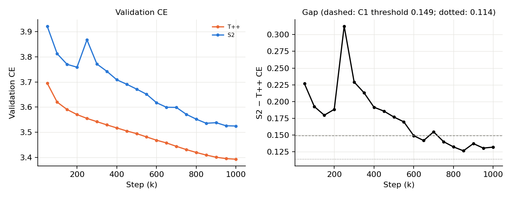
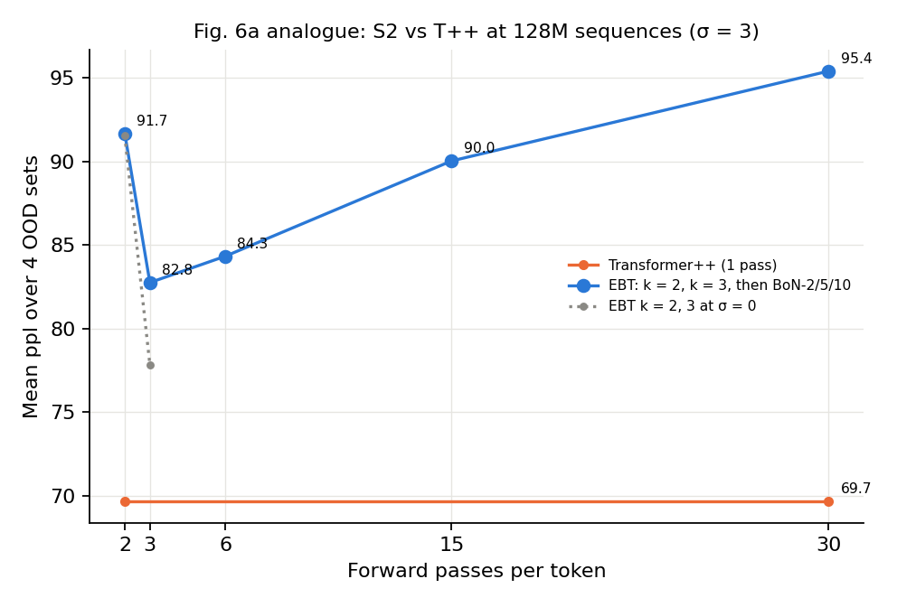
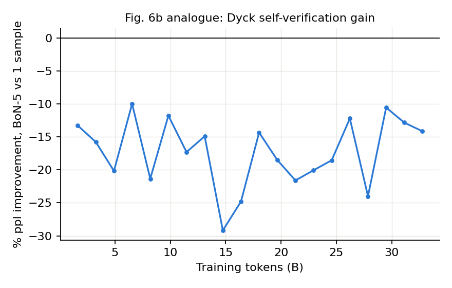
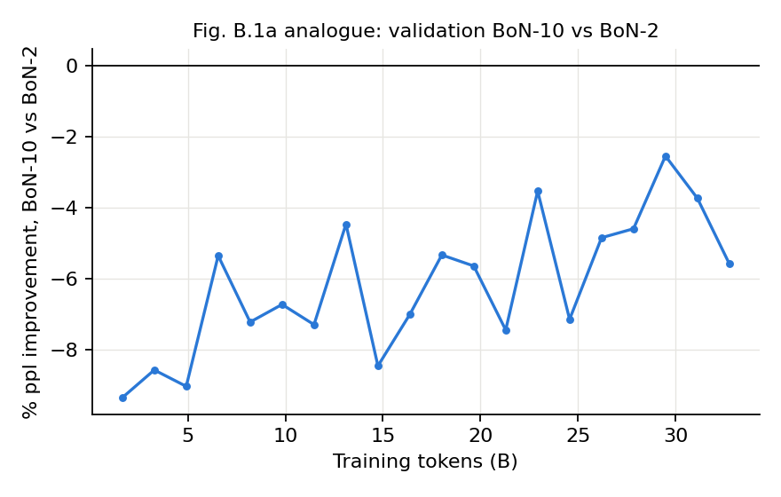
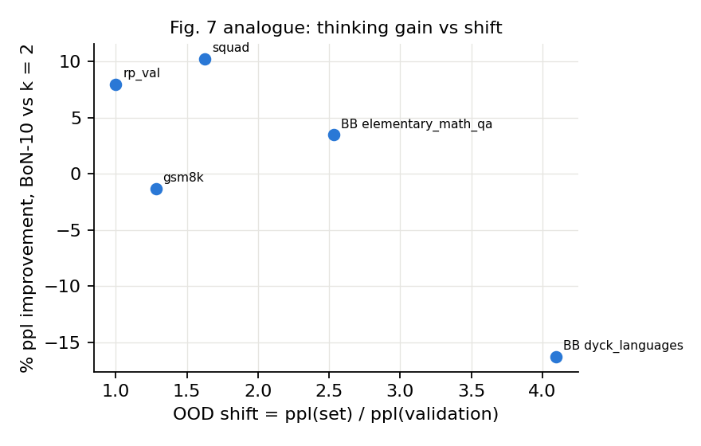
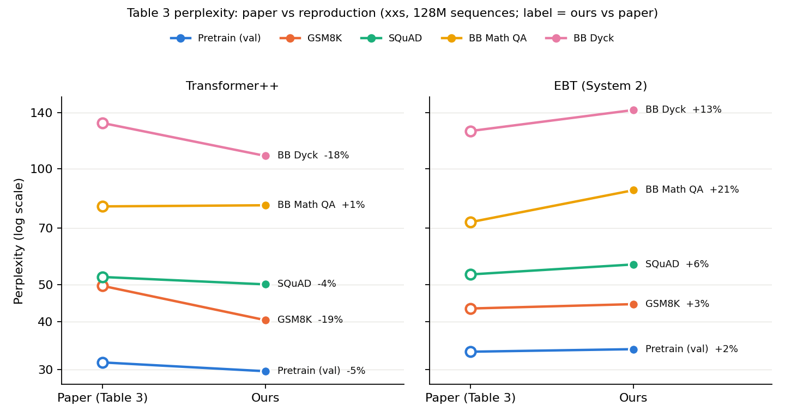

# Scale to paper level — EBT-S2 vs Transformer++ at 128M sequences

> [!summary] TL;DR
> - **The loss gap keeps shrinking but does not reach the paper.** At the paper's data scale (batch 128 × 1M steps = 128M sequences on the full RedPajama sample-100B, 66.4M documents), the S2 − T++ validation gap is **+0.132 nats**. It was +0.247 at 3.36M sequences and +0.179 at 16M. C1 is **Supported** (< 0.149), but the gap is about twice the paper's +0.064 and stays above the "matches paper" bar of 0.114.
> - **The paper's thinking claims do not reproduce at the paper's scale.** C2–C7 are all **Not supported**. The k = 2 → 3 gain on OOD perplexity is 9.7% at σ = 3, just under the 10% threshold (15.0% at σ = 0; the paper shows ≈ 20%). Self-verification (lowest-energy pick among candidates) makes OOD perplexity worse, not better: 82.8 → 95.4 from k = 3 to BoN-10. It is net-harmful on Dyck at every one of the 20 checkpoints. T++ beats S2 on all 4 OOD sets (paper: S2 wins 3 of 4). Against the paper's Table 3 (§2.4), our T++ is within 1% of the paper's T++ or better on every set, while our S2 is 1.5–21% worse than the paper's EBT, so the shortfall is on the EBT side.
> - **8× more data leaves the verifier where it was.** BoN-32 efficiency (−0.20) and pairwise consistency (0.626) are within 0.01 of the 3.36M and 16M values. The energy still ranks candidates by sharpness (R² of ΔE on Δentropy 0.973; entropy alone selects as well as E). What did improve is S2's relative deficit to T++ out of distribution: the S2/T++ ppl ratio on BB Elementary Math QA fell from 1.50 to 1.09.

## 1. Setup

| Item | Value |
|---|---|
| Runs | `tpp-paper` (Transformer++), `s2-paper` (EBT System 2), xxs (D = 384), one seed each (33) |
| Data | RedPajama-V2 sample-100B, all 8,400 shards, first 257 tokens per document: **66,387,864 documents** (1.006 × the paper's 66M; 0 missing shards; en 49.25M, de 5.49M, es 4.73M, fr 4.46M, it 2.44M) |
| Split | New random validation set of **33,000 documents** (`val_indices_paper_33000.npy`, numpy seed 33) / 66,354,864 train |
| Schedule | Global batch 128 (4 × 32 on GPUs 0–3, DDP) × 1,000,000 steps = 128M sequences ≈ **1.93 epochs** (one epoch = 518,398 steps); LR 0.0012, warm-up 10k, cosine to 1M, `min_lr_scale 10`; validation every 50k steps |
| S2 settings | As the earlier runs (paper Table D.4): Langevin σ = 3, step size 5 (randomized ×2), 2–3 MCMC steps, replay buffer, truncated MCMC |
| Evaluation | Thinking-study Q2 (32 candidates, ≤ 1,024 seqs, σ = 3) and Q3 Part A (k = 1…32, noise 0 and 3) on validation + 4 OOD sets at the Table 3 checkpoint; Q2 on validation and Dyck at all 20 S2 checkpoints |
| OOD sets | GSM8K test, SQuAD v2 validation, BB Elementary Math QA, BB Dyck Languages, as in the [OOD report](../../scale_to_16m_sequences/ood/report/report.md) (Dyck has only 200 items, 10,818 tokens) |

Plan and pre-registered claims (frozen before training, commit 625afaf): [IMPLEMENTATION_PLAN](../IMPLEMENTATION_PLAN.md) §0. Generated tables: [result.md](result.md). Earlier points: [scale-16m report](../../scale_to_16m_sequences/report/report.md) and [[SUMMARIZED_FINDINGS]].

**Table 3 checkpoint** (lowest validation loss) is the final step-1M checkpoint for both models.

### 1.1 Training runs

| Run | Wall-clock | Speed | Incidents |
|---|---|---|---|
| T++ | 10.7 h (attempt 2) | ≈ 27 it/s | Attempt 1 hung at the first validation. Attempt 2 was killed once by an outside tmux kill and resumed from step 800k |
| S2 | 89.9 h | ≈ 3.1 it/s | None (no resume, no NaN/Inf warnings in MCMC); two loss spikes, see §2.1 |

> [!note] Run incidents and fixes
> - **T++ attempt 1 deadlocked** at its first validation (step 50k):
>   - Rank 0 stopped at val batch 7/258, and the other ranks timed out in NCCL after 30 min.
>   - Cause: DataLoader workers forked from a multi-threaded rank 0 (logger, NCCL watchdog) inherited a held lock.
>   - Fix: `forkserver` workers (`--dataloader_mp_context`), plus `faulthandler` on SIGUSR1 and a log-stall watchdog (`watch_run.sh`).
>   - Check: validation losses with forkserver are identical to fork on the smoke runs.
>   - The run was restarted from scratch.
> - **T++ attempt 2 was interrupted** at step 846,649:
>   - Its tmux session was closed from outside. This was not a training error.
>   - It resumed from the step-800k checkpoint with `--resume_data_offset_steps 800000`, which reorders the training data so that the shuffled order continues where it stopped.
>   - About 46.6k steps were re-run.
> - **The resume validation is not used.** On restore, Lightning repeats the validation of the checkpoint step, but only on the 1 remaining batch. Its loss was 3.4519 vs the real 3.4196.
>   - The weights are identical (max abs difference 0).
>   - An offline evaluation of a small reproduction matches the original row, not the repeated one.
>   - `collect_paper.py` keeps the first row per step.
>   - The 16M report saw the same artefact and suspected this cause from the Lightning source; the run above confirms it.

## 2. Results

### 2.1 Validation loss and the gap (C1)

| Step (k) | 50 | 100 | 200 | 250 | 300 | 400 | 500 | 600 | 700 | 800 | 900 | 1000 |
|---|---|---|---|---|---|---|---|---|---|---|---|---|
| Sequences | 6.4M | 12.8M | 25.6M | 32M | 38.4M | 51.2M | 64M | 76.8M | 89.6M | 102.4M | 115.2M | 128M |
| T++ | 3.6951 | 3.6198 | 3.5702 | 3.5550 | 3.5420 | 3.5171 | 3.4945 | 3.4683 | 3.4439 | 3.4196 | 3.4006 | **3.3927** |
| S2 | 3.9218 | 3.8123 | 3.7586 | 3.8674 | 3.7713 | 3.7087 | 3.6715 | 3.6174 | 3.5987 | 3.5520 | 3.5380 | **3.5247** |
| Gap | +0.227 | +0.193 | +0.188 | +0.313 | +0.229 | +0.192 | +0.177 | +0.149 | +0.155 | +0.132 | +0.137 | **+0.132** |

All 20 points are in [result.md](result.md).



- **S2 had two training instabilities**, around step 210k and step 240k.
  - The train-loss maximum over a 10k-step window rose to 4.52 and 6.10, and the gradient-norm maximum to 0.77, against ≈ 0.1 typically.
  - The step-250k validation jumped to 3.867.
  - The run recovered without intervention: validation was back below its pre-spike level by 350k.
  - Whether the spike cost S2 loss at the end of the run cannot be told from one seed.
- **The gap closes until about 850k, then flattens** (+0.127 at 850k, +0.132 at 1M). T++ keeps improving slightly to the end, while S2 stalls between 850k and 1M (3.536 → 3.525).
- **Cross-scale series** (the 128M point uses a different validation set; both sets are random RedPajama documents, so gaps are comparable but absolute losses are not):

| Sequences seen | 3.36M (b32) | 16M (b64) | 128M (b128) | Paper (128M) |
|---|---|---|---|---|
| S2 − T++ validation CE | +0.247 | +0.179 | **+0.132** | +0.064 |

In log-sequences, the gap fell by 0.068 over the first 4.8× of data and by 0.047 over the next 8×. The decrease is slower than linear in log data. The paper's point lies well below this trend.

### 2.2 Thinking Longer and Self-Verification on OOD data (C2, C3; Fig. 6a)

Mean perplexity over the 4 OOD sets (S2 at σ = 3 unless noted):

| Variant | Forward passes | 16M (OOD report) | **128M** | Paper (read off Fig. 6a) |
|---|---|---|---|---|
| Transformer++ | 1 | 67.6 | **69.7** | – |
| No Thinking (k = 2) | 2 | 100.8 | **91.7** | 44.8 |
| Thinking Longer (k = 3) | 3 | 91.1 | **82.8** | 35.9 |
| Self-Verification BoN-2 | 6 | 93.7 | **84.3** | – |
| BoN-5 | 15 | 99.7 | **90.0** | – |
| BoN-10 | 30 | 105.5 | **95.4** | 31.8 |
| k = 2 / k = 3 at σ = 0 (secondary) | 2 / 3 | 101.7 / 84.5 | **91.5 / 77.8** | – |



> [!note] The paper's Fig. 6a values are compared only as relative changes
> Fig. 6a's absolute values (31.8–44.8) cannot be the arithmetic mean of the paper's own Table 3 over the same 4 sets (EBT 73.6, T++ 78.3), so Fig. 6a uses an aggregation or subset the paper does not state. Our absolute values are on the scale of Table 3 (§2.4), and C2/C3 use only the relative drops.

- **C2 (k = 2 → 3 lowers OOD ppl by > 10%): Not supported, narrowly.**
  - At σ = 3 the drop is 9.7%, almost the same as at 16M (9.6%). At σ = 0 it is 15.0% (16.9% at 16M).
  - The paper shows ≈ 20% and does not state its σ.
  - The direction reproduces at every scale; the size does not reach the pre-registered 10% at σ = 3.
  - The verdict also depends on the averaging convention. "Mean OOD ppl" is the arithmetic mean of per-set ppl (as in the OOD report), which Dyck dominates (ppl ≈ 150, but only 2.5% of OOD tokens). With a geometric mean (mean CE over sets) the drop is 10.65%, and token-weighted it is 12.2%; both pass 10%. The pre-registered convention stands; C3 is negative under all three (−15.3% / −12.5% / −9.0%).
- **C3 (BoN-10 lowers it further by > 2%): Not supported, reversed.** BoN-10 is 15.3% *worse* than k = 3 (82.8 → 95.4), and perplexity rises monotonically with N, as at 16M.
- More data lowered every S2 variant by ≈ 8–10% in perplexity, while the T++ mean rose (67.6 → 69.7; see §2.4). So the whole S2 curve moved toward T++, but its shape did not change.

### 2.3 Self-verification over training (C4, C5; Fig. 6b, Fig. B.1a)




| Quantity (S2, σ = 3) | 50k | 250k | 500k | 750k | 1M | Spearman with tokens (20 points) |
|---|---|---|---|---|---|---|
| Dyck: % ppl improvement of BoN-5 over one sample | −13.3 | −21.4 | −24.8 | −18.5 | **−14.2** | +0.04 |
| Validation: % ppl improvement of BoN-10 over BoN-2 | −9.3 | −7.2 | −7.0 | −7.1 | **−5.6** | +0.68 |

- **C4: Not supported.** On Dyck, picking the lowest-energy candidate among 5 is worse than taking one sample at every checkpoint (range −10.0% to −29.2%), with no trend. Dyck has only 10,818 tokens, so the per-checkpoint values are noisy. The paper reports +4–8% early and +10–14% late.
- **C5: Not supported.** The validation curve does move in the paper's direction (ρ = +0.68; −9.3% → −5.6%), so the harm of a larger N shrinks with training. But it stays negative at every checkpoint: BoN-10 is never better than BoN-2.

### 2.4 Per-set perplexity, OOD shift and Table 3 (C6, C7; Fig. 7)

| Set | Tokens | T++ ppl | S2 ppl (1 sample, k = 3) | S2 / T++ (16M → 128M) | S2 BoN-10 | OOD shift | Max Thinking vs No Thinking |
|---|---|---|---|---|---|---|---|
| RedPajama val | 229,950 | 30.36 | 34.68 | 1.19 → **1.14** | 36.18 | 1.00 | +8.0% |
| GSM8K | 159,980 | 40.38 | 44.45 | 1.14 → **1.10** | 49.74 | 1.28 | −1.3% |
| SQuAD | 181,426 | 50.03 | 56.37 | 1.21 → **1.13** | 59.52 | 1.63 | +10.3% |
| BB Elementary Math QA | 81,451 | 80.34 | 87.92 | 1.50 → **1.09** | 97.06 | 2.54 | +3.5% |
| BB Dyck Languages | 10,818 | 107.96 | 142.11 | 1.41 → **1.32** | 175.30 | 4.10 | −16.3% |

"Max Thinking vs No Thinking" = % ppl improvement of BoN-10 over k = 2 (σ = 3).



- **C6: Not supported.** Spearman(shift, Max-Thinking gain) = −0.50 over 5 points, the opposite sign to the paper's Fig. 7.
  - Where Max Thinking is positive, the gain comes from the k = 2 → 3 step, not from the selection. On every set, BoN-10 is worse than k = 3 alone.
  - Selection costs most on Dyck, the most shifted set (BoN-10 vs k = 3: −23.6%), then GSM8K (−11.7%), BB math (−9.9%), SQuAD (−5.5%) and validation (−4.5%). The loss is not ordered by shift beyond Dyck.
- **C7: Not supported.** S2 ppl is above T++ on all 4 OOD sets (paper: S2 lower on 3 of 4).
  - S2's relative deficit did shrink on every set, most on BB Elementary Math QA (1.50 → 1.09).
  - Part of that shrinkage comes from T++ getting worse on the BigBench sets: Dyck 92.3 → 108.0 and BB math 75.1 → 80.3, while T++ improved on GSM8K (48.7 → 40.4) and SQuAD (54.4 → 50.0).
  - With one seed and only 10.8K Dyck tokens, we do not interpret the T++ change.

#### Direct comparison with the paper's Table 3

Both setups pretrain once on RedPajamaV2 (xxs, batch 128 × 1M steps), take the best checkpoint and report zero-shot perplexity; the paper uses no fine-tuning or post-training (§4, App. D.1.2). The paper does not state the inference σ or k behind Table 3, so S2 is shown at the pre-registered σ = 3 and at σ = 0 (both k = 3, one sample).

| Set | T++ paper | T++ ours | EBT paper | S2 ours σ = 3 | S2 ours σ = 0 | EBT / T++ paper | S2 / T++ ours (σ = 3 / σ = 0) |
|---|---|---|---|---|---|---|---|
| Pretrain (validation) | 31.36 | 29.75 | 33.43 | 33.94 | – | 1.066 | 1.141 / – |
| GSM8K | 49.6 | 40.38 | 43.3 | 44.45 | 42.80 | 0.873 | 1.101 / 1.060 |
| SQuAD | 52.3 | 50.03 | 53.1 | 56.37 | 56.55 | 1.015 | 1.127 / 1.130 |
| BB Elementary Math QA | 79.8 | 80.34 | 72.6 | 87.92 | 83.61 | 0.910 | 1.094 / 1.041 |
| BB Dyck Languages | 131.5 | 107.96 | 125.3 | 142.11 | 128.40 | 0.953 | 1.316 / 1.189 |
| Mean of the 4 OOD sets | 78.3 | 69.68 | 73.6 | 82.71 | 77.84 | 0.940 | 1.187 / 1.117 |

"Pretrain (validation)" for us is exp(validation CE) over all 33,000 validation documents at step 1M as logged in training (the 1,024-sequence eval subset gives 30.36 / 34.68). The paper's validation set is a different random sample of the same corpus.



- **Our T++ matches or beats the paper's T++.** It is within 1% on BB math (+0.7%) and lower on every other set: by 4–5% on validation and SQuAD and by 18–19% on GSM8K and Dyck. Our evaluation therefore produces numbers on the paper's scale, and a weaker T++ reference does not explain C7.
- **Our S2 is worse than the paper's EBT on every set at σ = 3**, from +2.7% (GSM8K) and +1.5% in-distribution to +13% (Dyck) and +21% (BB math). At σ = 0 it is within 3% on GSM8K (−1.2%) and Dyck (+2.5%), but still +6.5% on SQuAD and +15% on BB math.
- **The paper's Table 3 wins rest on both sides of the ratio.** On GSM8K and Dyck our S2 at σ = 0 is below the paper's T++ (42.8 vs 49.6; 128.4 vs 131.5) but above our own T++, because our T++ is 18–19% lower there. Neither the paper nor we measure seed variance, and Dyck has 200 items, so T++ differences of this size between independent runs cannot be ruled out. The win/loss count of C7 is therefore sensitive to the T++ reference run.
- **σ = 0 does not change C7:** S2 is above T++ on all 4 OOD sets at either σ.

### 2.5 The verifier and the landscape across scales (Task 8 follow-up)

Because C3–C6 failed, the plan's optional follow-up was run on the final S2 checkpoint (validation only):
- Q2 entropy-vs-energy;
- Q3 Part A with 256 sequences (as the earlier points), plus Part B.

| Metric (S2, validation, σ = 3) | 3.36M / b32 | 16M / b64 | **128M / b128** |
|---|---|---|---|
| BoN-32 efficiency | −0.20 | −0.21 | **−0.20** |
| Pairwise consistency (\|ΔCE\| > 0.1) | 0.623 | 0.628 | **0.626** |
| CE(energy pick) − CE(random pick), N = 2 / 4 / 8 / 16 / 32 | −0.010 / +0.006 / +0.035 / +0.068 / +0.102 | −0.010 / +0.006 / +0.034 / +0.066 / +0.099 | **−0.011 / +0.005 / +0.034 / +0.066 / +0.100** |
| Lower E ⇒ lower entropy (pairs) | 0.982 | 0.975 | **0.967** |
| R² of ΔE ~ ΔH (candidate pairs) | 0.976 | 0.976 | **0.973** |
| Lower E right / lower H right / residual (E\|H) right | 62.3 / 62.2 / 56.7% | 62.8 / 62.6 / 56.6% | **62.6 / 62.5 / 56.6%** |
| BoN-32 CE selecting by E / by H (candidate 0; oracle) | 4.023 / 4.028 (3.922; 3.414) | 3.799 / 3.804 (3.701; 3.221) | **3.645 / 3.651 (3.546; 3.058)** |
| AUROC energy / entropy → top-1 error | 0.628 / 0.806 | 0.670 / 0.815 | **0.589 / 0.819** |
| Spearman(energy, CE) across tokens | 0.233 | 0.353 | **0.180** |
| k = 2 → 3 CE, noise 0 (256 seqs) | 4.143 → 3.943 (−0.200) | 3.924 → 3.724 (−0.200) | **3.709 → 3.587 (−0.122)** |
| k = 32 penalty vs k = 3, noise 0 | +0.097 | +0.093 | **+0.106** |

| Q3 Part B metric (t = 0 / 2 / 31) | 16M / b64 | **128M / b128** |
|---|---|---|
| Median spectral radius ρ of the update Jacobian | 1.86 / 0.62 / 0.47 | **1.09 / 0.75 / 0.54** |
| Share of negative Hessian eigenvalues | 92% / 30% / 28% | **82% / 35% / 32%** |
| Tokens locally convex | 0% / 0% / 0% | **0% / 0% / 0%** |
| λ_max / median\|λ\| | 8.5 / 104 / 76 | **14.5 / 90 / 68** |
| Participation ratio of ∇_eE (of 384) | 37.4 / 24.1 / 24.9 | **37.9 / 23.3 / 24.0** |
| Line argmin s along the update at t = 2: CE / E / Φ | 1.625 / 2.0 / 0.875 | **1.75 / 2.0 / 1.0** |
| Median steps to converge (TV < 0.01, noise 0) | 7 | **9** |
| Spearman(steps to converge, entropy) | 0.82 | **0.82** |
| Tokens not converged / in a 2-cycle at t = 31 (noise 0) | 14.4% / 13.2% | **32.7% / 29.9%** |

- **The verifier is unchanged across a 38× range of data.** The BoN curve, efficiency and consistency are within 0.01 of the 3.36M and 16M values. The energy is still almost a linear function of entropy when ranking candidates of one token (R² 0.973). Selecting by entropy alone gives a BoN-32 CE within 0.006 nats of selecting by E, and both are worse than no selection.
- **As an across-token uncertainty signal, the energy got worse.** AUROC fell from 0.670 to 0.589 and Spearman(E, CE) from 0.353 to 0.180, which reverses the 3.36M → 16M improvement. Entropy stays at ≈ 0.82.
- **The paper's k = 2 → 3 step is smaller in distribution** (−0.122 vs −0.200 nats). One reason is that k = 2 is already much better at 128M (3.709 vs 3.924 at 16M), but this set and its baseline differ from the earlier points, so treat the comparison as indicative only.
- **The landscape findings hold at 128M:**
  - E is nowhere locally convex.
  - The loop contracts after the first steps.
  - The update is line-optimal for Φ (s = 1.0) rather than for E (s = 2.0, the edge of the grid).
  - Steps to converge still track entropy (0.82).
- **What changed is the late loop:** about twice as many tokens end unconverged in a 2-cycle at t = 31 (29.9% vs 13.2%), and the k = 32 penalty grew slightly (+0.106). The trained 2–3-step regime is unaffected, but extrapolating past it is somewhat less stable than at 16M.

## 3. Verdicts on the pre-registered claims

| # | Paper claim | Supported if (§0.2) | 128M result | Paper | Verdict |
|---|---|---|---|---|---|
| C1 | S2 − T++ gap keeps shrinking with data | gap < 0.149; paper match ≤ 0.114 | +0.132 | +0.064 | **Supported** (not a paper match) |
| C2 | Thinking Longer lowers OOD ppl (Fig. 6a) | k = 2 → 3 mean OOD ppl drop > 10% | 9.7% (σ = 3); 15.0% at σ = 0, secondary; 10.65% with a geometric mean | ≈ 20% | **Not supported** (narrowly; convention-dependent) |
| C3 | Self-Verification lowers it further (Fig. 6a) | BoN-10 vs k = 3 drop > 2% | −15.3% (rises) | ≈ 11% | **Not supported** (reversed) |
| C4 | Verification gain grows with training (Fig. 6b) | Dyck BoN-5 gain > 0 at the end and ρ > 0 | −14.2%, ρ = +0.04 | 4–8% → 10–14% | **Not supported** |
| C5 | Fewer adversarial samples with training (Fig. B.1a) | val BoN-10 vs BoN-2 gain > 0 at the end and ρ > 0 | −5.6%, ρ = +0.68 | qualitative | **Not supported** (trend right, sign wrong) |
| C6 | Thinking gain grows with OOD shift (Fig. 7) | ρ(shift, Max-Thinking gain) > 0 | ρ = −0.50 | 12% → 23% | **Not supported** (reversed) |
| C7 | EBT beats T++ downstream (Table 3) | S2 < T++ on ≥ 3 of 4 OOD sets | 0 of 4 | 3 of 4 | **Not supported** |

## 4. Interpretation

- **Scale was the remaining explanation, and it does not rescue the thinking claims.** This run matches the paper's data scale (66M documents, 128M sequences, batch 128). The pre-registered thresholds were set well below the paper's values. Still, only the loss-gap claim passes, and its gap is twice the paper's.
- **Loss and "thinking" decouple, as at 16M.** More data steadily narrows S2's loss deficit, in distribution and out of it. Yet every property of the energy as a *selector* is fixed across 3.36M → 16M → 128M sequences: BoN curve, efficiency, consistency, and the sharpness bias.
  - This fits the structural reading in [[SUMMARIZED_FINDINGS]] §2.1: the training loss never asks the energy to rank candidates.
  - It also fits the inference loop being a fixed point of Φ = αE − H − ½‖p‖², not a descent on E. Neither property depends on data scale.
  - This is an interpretation consistent with the data, not a tested causal claim.
- **The shortfall against the paper is on the EBT side.** Our T++ is at or below the paper's Table 3 T++ on every set, while our S2 is above the paper's EBT on every set (§2.4). The open question is therefore why an S2 trained with the paper's Table D.4 settings ends 1.5–21% worse than the paper's EBT. Candidates are unstated hyperparameters or MCMC details, seed variance and the document sampling of the data build; none is tested here.
- **The one robust "thinking" effect is running the loop to its trained length.** k = 2 → 3 helps at every scale and on every set. It is part of S2's normal inference, which T++ does not need, and it is the only source of the positive Max-Thinking gains in §2.4.
- **C5 is the only thinking quantity that trends in the paper's direction.** The harm of BoN-10 vs BoN-2 on validation shrinks with training (ρ = +0.68). Extrapolating that trend linearly, the sign would flip only well beyond 1M steps. This is speculative, with one seed.

> [!warning] Limitations
> - **One seed per model.** The S2 loss spikes (§2.1) show that single-run variance can be large; differences of a few hundredths of a nat between scales are not separable from seed noise.
> - **xxs only** (D = 384). If the paper's thinking model was larger (Table D.4 "Small"), our models are ≈ 8× smaller in non-embedding parameters. Whether the thinking claims need model scale, not data scale, is not tested.
> - **New validation set at 128M.** Absolute in-distribution losses and the k = 2 → 3 in-distribution numbers are not comparable with the 3.36M/16M points; gaps and OOD sets are.
> - **Inference settings of the paper are not stated** (σ, k for Table 3; token scoring; percentage baselines; the aggregation behind Fig. 6a's absolute values). §0.1 fixed ours in advance; C2 would pass at σ = 0 (15.0%) or with a geometric/token-weighted OOD mean (10.65% / 12.2%), but σ = 3 and the arithmetic mean of per-set ppl are the pre-registered setting.
> - **T++ was resumed once at 800k** (data order continued; ≈ 46.6k steps re-run). **S2 trained ≈ 1.93 epochs**, so part of the data was seen twice, as in the paper's 1M steps over 66M documents.
> - **Dyck is small** (200 items, 10,818 tokens), so the C4 curve is noisy.
> - **Different T++ references across scales**, so the off-trajectory and OOD T++ numbers change with the T++ model as well as with S2.

## 5. Reproduction

```bash
cd code/EBT/experiments/scale_to_paper_level
PY=/home/quangnx/miniconda3/envs/ebt312/bin/python
bash build_data.sh full                                   # ~12 h CPU -> data/full, logs/data_stats.json
$PY make_val_indices.py data/full                         # val_indices_paper_33000.npy (committed)
$PY extract_val_subset.py                                 # data/val_subset (17 MB): rp_val without data/full
GPU_IDS=0,1,2,3 bash watch_run.sh logs/tpp_paper.log run_tpp.sh --run_name tpp-paper    # ~11 h
GPU_IDS=0,1,2,3 bash watch_run.sh logs/s2_paper.log  run_s2.sh  --run_name s2-paper     # ~90 h
# after an interruption, N = global step of last.ckpt (this run: T++ at N = 800000):
GPU_IDS=0,1,2,3 bash watch_run.sh logs/tpp_paper_r1.log run_tpp.sh --run_name tpp-paper \
  --resume_training_ckpt <abs path>/last.ckpt --resume_data_offset_steps N
# evaluation, ~1.2 h on 4 GPUs
GPU_ID=0 PART=final DATASETS="rp_val gsm8k squad" bash run_eval.sh
GPU_ID=1 PART=final DATASETS="bigbench_elementary_math_qa bigbench_dyck_languages" bash run_eval.sh
GPU_ID=2 PART=curve DATASETS=rp_val bash run_eval.sh
GPU_ID=3 PART=curve DATASETS=bigbench_dyck_languages bash run_eval.sh
$PY collect_paper.py                                      # report/result.md, report/figures/*.png
# §2.5 follow-up
$PY ../scale_to_16m_sequences/entropy_vs_energy.py results/q2/s2_paper_step1000000_rp_val_noise3
export EBT_VAL_SUBSET=$PWD/data/val_subset                # run_eval.sh sets this itself
cd ../.. && export PYTHONPATH="$PWD:$PWD/experiments/thinking_study/common" CUDA_VISIBLE_DEVICES=0
O=experiments/scale_to_paper_level/results/q3/s2_paper_step1000000_rp_val_partb
$PY experiments/thinking_study/q3_energy_landscape/run_q3.py --model s2_paper --step 1000000 --data rp_val --out-dir $O
$PY experiments/thinking_study/q3_energy_landscape/analyze_q3.py $O
$PY experiments/thinking_study/q3_energy_landscape/analyze_q3_extra.py $O
```
