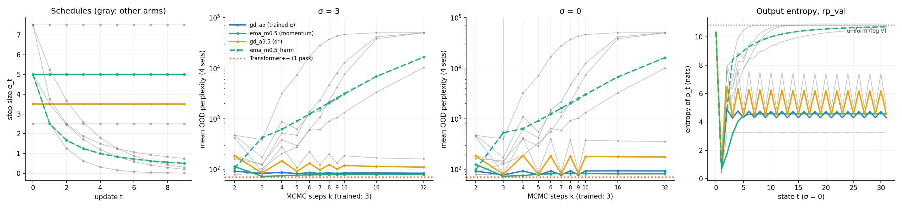

# Step-size decay — does a smaller step explain the EMA momentum gain?

> [!summary] TL;DR
> - **No, for every schedule tested.** All of them are worse than the trained constant α = 5 at k = 3, and far worse than EMA momentum. The arm selected on rp_val (`gd_a3.5`) reaches 84.42 mean OOD ppl at k = 3, against `gd_a5` 82.76 and `ema_m0.5` 72.21; its deficit against `gd_a5` is significant on 4 of 5 sets, but not on Dyck. Decaying schedules reach 102.6–384.1 at k = 3 and drift toward a uniform distribution with more steps. D1's pre-registered verdict is **"momentum does more"**, and D2–D5 are not supported.
> - **Under decay, the output flattens toward uniform.** Each update re-anchors at the probabilities, z_{t+1} = p_t − α_t u_t, with p_t ∈ [0, 1], so a shrinking α_t limits how far the logits can move from p_t. Entropy climbs to log V, and `gd_a5_g0.5` ends at ppl 50,277 = V. This is consistent with α setting the logit scale, but logit norms and |u| were not recorded. A smaller *constant* α does not simply raise the temperature: at odd t its entropy matches α = 5, and its 2-cycle gets worse (64–78% of tokens vs 29.6%).
> - **Hypothesis, not measured: EMA's damping is selective rather than global.** Decay damps the even/odd oscillation only by freezing or flattening the state. EMA removes it while staying sharp. Adding a harmonic decay to EMA (`ema_m0.5_harm`) costs the gain at k = 3 (424.0). The momentum report's open question (§2.3 there) is answered for the global schedules tested. A damping that leaves the logit scale unchanged was not tested.

## 1. Setup

| Item | Value |
|---|---|
| Checkpoint | `s2_paper`, step 1M (the momentum report's checkpoint) |
| Sequences | 1,024 per set (rp_val + 4 OOD), batch 16, `torch.manual_seed(seed + b)`, k = 1…32 recorded per step |
| Pairing | Same sequences and seeds as the momentum grid; the constant-schedule path reproduces `gd_a5` bit-exactly (`test_run_decay.py`, GPU; rp_val, σ = 3, first 64 sequences; run and passed before the grid) |
| Noise | σ ∈ {0, 3}; σ is added to the logits each step and is not decayed |
| Selection | `d*` = lowest rp_val CE at k = 3, σ = 3 among the 7 GD arms |
| Metric | Arithmetic mean of the 4 OOD sets' ppl at k = 3, σ = 3 |

Arms (α_t of update t = 0, 1, …; update 0 leaves the random initial state):

| Arm | α₀, α₁, α₂ | Schedule |
|---|---|---|
| `gd_a2.5`, `gd_a3.5` | 2.5 / 3.5 constant | small constant step |
| `gd_a5_harm` | 5, 2.5, 1.67 | α₀ / (t + 1) |
| `gd_a5_g0.5` | 5, 2.5, 1.25 | α₀ · 0.5^t |
| `gd_a5_g0.7` | 5, 3.5, 2.45 | α₀ · 0.7^t |
| `gd_a7.5_harm` | 7.5, 3.75, 2.5 | α₀ / (t + 1) |
| `gd_a7.5_g0.7` | 7.5, 5.25, 3.67 | α₀ · 0.7^t |
| `ema_m0.5_harm` | 5, 2.5, 1.67 | EMA (μ = 0.5) + harmonic decay |

## 2. Results

### 2.1 Pre-registered claims

| # | Claim | Value | Supported if | Verdict |
|---|---|---|---|---|
| D1 | A step-size schedule explains the EMA gain | `gd_a3.5`: 84.42 (EMA 72.21, `gd_a5` 82.76) | ≤ 73.2 most / ≥ 78.0 momentum does more | **momentum does more** |
| D2 | Decay beats the trained constant step | −2.0% (worse), CI < 0 on 0/4 | > 2%, CI < 0 on ≥ 3/4 | **Not supported** |
| D3 | Decay removes the 2-cycle | `gd_a3.5`: 63.9% (`gd_a5` 29.6%) | < 5% | **Not supported** |
| D4 | Decay stops the drift with k | +30.4% from k = 3 to 32 (EMA +8.5%) | < +2% | **Not supported** |
| D5 | (exploratory) Momentum and decay add up | `ema_m0.5_harm` 424.0 vs 72.21 | CI < 0 on ≥ 3/4 | **Not supported** |

Note on D3 and D4: the selection picked a *constant* small α, because every decaying arm is worse on rp_val (CE 3.79–5.01 vs 3.59). The decaying arms show 0% 2-cycles at t = 31, but that metric is nearly vacuous for them: their state has frozen (median TV at t = 30 is 4e-8 for `gd_a5_g0.5`), and a damped zig-zag is still visible at small k (§2.3). They also fail on perplexity, so the claim the plan meant to test fails either way.

### 2.2 Perplexity (k = 3, σ = 3)

| Set | T++ ours | `gd_a5` | `ema_m0.5` | `gd_a3.5` (d*) | `ema_m0.5_harm` | d* vs `gd_a5`: ΔCE [95% CI] | d* vs EMA: ΔCE [95% CI] |
|---|---|---|---|---|---|---|---|
| Pretrain (val) | 30.36 | 34.63 | 33.73 | 36.23 | 156.35 | +0.045 [+0.043, +0.047] | +0.071 [+0.069, +0.074] |
| GSM8K | 40.38 | 44.55 | 42.15 | 46.52 | 242.80 | +0.043 [+0.041, +0.045] | +0.099 [+0.095, +0.102] |
| SQuAD | 50.03 | 56.41 | 54.00 | 58.44 | 306.69 | +0.035 [+0.033, +0.037] | +0.079 [+0.076, +0.082] |
| BB Math QA | 80.34 | 88.32 | 70.87 | 90.03 | 492.19 | +0.019 [+0.016, +0.022] | +0.239 [+0.234, +0.245] |
| BB Dyck | 107.96 | 141.77 | 121.82 | 142.70 | 654.30 | +0.006 [−0.005, +0.018] | +0.158 [+0.144, +0.172] |
| Mean of 4 OOD | 69.68 | 82.76 | 72.21 | 84.42 | 424.00 | | |

Mean OOD ppl at k = 3, σ = 3, of the other arms (all post hoc):
- **Small constant α:** `gd_a2.5` 90.0.
- **Decaying schedules:** `gd_a7.5_g0.7` 102.6, `gd_a5_g0.7` 120.9, `gd_a7.5_harm` 126.3, `gd_a5_harm` 171.4, `gd_a5_g0.5` 384.1.

Over all k ≤ 32, the best new arm is `gd_a3.5` at k = 3: 84.4 at σ = 3 (EMA 72.2) and 79.4 at σ = 0 (EMA 72.7); see `report/result.md`.



### 2.3 Mechanism: α sets the logit scale

The loop re-anchors at the probabilities each step (`../energy_momentum/momentum.py`):

```python
p = softmax(z + noise)            # p in [0, 1]
z = p - alpha_t * u               # logits = O(1) + alpha_t * u
```

Because p_t is bounded, the logits' spread equals that of α_t · u_t up to O(1). This is an identity, not evidence: u = g adapts to p. The entropies below are consistent with α setting the logit scale *under decay*, and with α acting as a temperature at t = 1 (entropy 0.40 / 0.67 / 1.12 nats at α = 7.5 / 5 / 3.5). They do not show a pure temperature effect for a smaller constant α. Logit norms and |u| were not recorded.

| Arm (rp_val, σ = 0) | Entropy of p_t, t = 1…6 (nats; log V = 10.83) | 2-cycle share, t = 31 |
|---|---|---|
| `gd_a5` | 0.67, 4.88, 4.27, 4.77, 4.31, 4.75 | 29.6% |
| `ema_m0.5` | 0.67, 1.76, 3.14, 4.05, 4.43, 4.53 | 0.0% |
| `gd_a3.5` | 1.12, 6.47, 4.35, 6.34, 4.41, 6.30 | 63.9% |
| `gd_a5_harm` | 0.67, 7.94, 6.91, 8.96, 8.49, 9.31 | 0.0% |
| `gd_a5_g0.5` | 0.67, 7.94, 8.35, 9.94, 10.44, 10.71 | 0.0% |
| `gd_a7.5_g0.7` | 0.40, 4.69, 5.87, 6.72, 7.74, 8.44 | 0.0% |

- **Decay damps the oscillation as α → 0, while the state freezes or flattens.** The zig-zag is still visible at small k, damped and riding on an upward drift: `gd_a5_harm` at σ = 0 goes 171 → 1105 → 542 → 1359 from k = 3 to 6, and its entropy goes 7.94 → 6.91 → 8.96 → 8.49. Entropy rises toward log V. At k = 32, `gd_a5_g0.5` has mean OOD ppl 50,277: per-set CE is 10.825 = ln V, which is the uniform distribution over the vocabulary. Damping the oscillation this way does not give the EMA gain.
- **A smaller constant α makes the oscillation worse.** The 2-cycle share is 63.9% at α = 3.5 and 78.1% at α = 2.5, against 29.6% at α = 5. The entropy alternates (≈ 4.4 ↔ 6.4 nats for α = 3.5, ≈ 4.7 ↔ 7.7 for α = 2.5), so perplexity is good at odd k and bad at even k. For `gd_a2.5` at σ = 0, ppl is 83.2 at k = 3 and 443.9 at k = 2. The best odd-k values (83.2 / 79.4 at k = 3, σ = 0) are near `gd_a5` (77.8) and still above EMA (72.7).
- **A hypothesis for EMA, not measured here: it damps only the alternating component.** Bias-corrected EMA divides the weighted gradient sum by the weights' sum. Where consecutive gradients agree, |u| ≈ |g| and the logit scale would be kept; where they alternate, they cancel. Gradient cosines and |u| per step would test this.
- **EMA plus decay.** Adding a harmonic decay to EMA (`ema_m0.5_harm`) makes k = 3 much worse (424.0) and the drift with k much faster. Post hoc, it is *better* than `ema_m0.5` at k = 2: 104.2 vs 113.4 at σ = 3, and 98.0 vs 124.9 at σ = 0.
- **Scope.** The control covers α ∈ {2.5, 3.5, 5, 7.5, …} and 5 decay schedules. α = 3, 4, values between 5 and 7.5, and late decay were not run. The trend at k = 3 (2.5 → 90.0, 3.5 → 84.4, 5 → 82.8, 7.5 → 86.5) leaves little room for a constant α near 72.

## 3. Interpretation

- **The momentum report's main caveat is answered for the global schedules tested.** "The trained α = 5 is too large at inference, and a smaller or decaying α would do as well" does not hold here: both constant α < 5 and all 5 decay schedules are worse than α = 5 at k = 3, and far worse than EMA. At k = 2, `gd_a7.5_g0.7` (87.4) is better than `gd_a5` (91.7), but every arm's k = 2 value is far from EMA's 72.2 at k = 3.
- **"Step size" is an imperfect control in a re-anchored loop.** The plan treated α as a pure step size. Under decay, shrinking α also shrinks how far the logits move from the bounded p, which is consistent with the flattening seen. My expectation before the run (decay lands at 73–78) was wrong. Why EMA works, possibly by direction-selective damping, remains a hypothesis.
- **What remains untested** is a control that damps the update without changing the logit scale. Examples are a non-re-anchored loop z_{t+1} = z_t − α_t g_t, or decaying α while rescaling the logits to a fixed norm. Such a control would separate "averaging directions" from "selective damping of alternating components". These are new update rules rather than step-size controls, and for this question they are close to what EMA already is.

> [!warning] Limitations
> - One checkpoint (`s2_paper` 1M), one noise seed set, and 1,024 sequences per set. The bootstrap CI resamples sequences only.
> - The noise σ is not decayed with α. At σ = 0, which has no noise, the decay arms fail the same way (§2.3), so noise is not the cause.
> - The schedules are coarse (harmonic, geometric 0.5 / 0.7, constant 2.5 / 3.5). None of them decays only after the first 2–3 updates, which is where EMA's own k = 3 optimum sits. Given the entropy mechanism, a late decay would also flatten p at large k.
> - The full-set Table 3 protocol (plan Task 5) was not run, because D1's verdict was not "explains most" or "partial".

## 4. Reproduction

```bash
cd code/EBT/experiments/scale_to_paper_level/step_size_decay
PY=/home/quangnx/miniconda3/envs/ebt312/bin/python
$PY -m pytest -q                                          # incl. GPU test: const schedule == gd_a5 grid
GPU_ID=0 ARMS="gd_a5_harm gd_a2.5" bash run_all.sh        # ~20 min per GPU
GPU_ID=1 ARMS="gd_a5_g0.5 gd_a3.5" bash run_all.sh
GPU_ID=2 ARMS="gd_a5_g0.7 gd_a7.5_g0.7" bash run_all.sh
GPU_ID=3 ARMS="gd_a7.5_harm ema_m0.5_harm" bash run_all.sh
export PYTHONPATH=$PWD/../../..:$PWD/../../thinking_study/common:$PWD/../../thinking_study/q3_energy_landscape:$PWD/..:$PWD/../energy_momentum:$PWD
$PY collect_decay.py                                      # report/result.md, report/figures/ce_vs_k.png
```
