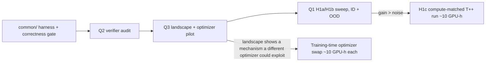

# EBT Thinking Study — Research Plan

> [!summary] TL;DR
> - Three questions, all answerable on the existing xxs checkpoints (Transformer++, EBT-S1, EBT-S2 from `reproduce_xxs_scaling`) **without new training**: Q1, does EBT thinking beat Transformer++; Q2, is lower energy a reliable sign of a better prediction (Gap 2); Q3, what the energy landscape looks like (convergence, curvature, anisotropy, effective dimension, alignment with loss), to judge the feasibility and mechanism of replacing plain GD in the *training* inner loop (Gap 3).
> - All three share one evaluation harness that re-implements the MCMC loop and logs per-token energy, gradient norm and cross-entropy for every step and candidate. It must first reproduce each checkpoint's logged validation loss.
> - Order: Q2 → Q3 → Q1 (H1a/H1b), each a few GPU-hours at most. A compute-matched Transformer++ run (H1c, ~10 GPU-h) and training-time optimizer swaps (future work) are gated on those results.

## 1. Motivation

- The EBT paper's thinking claims ([[Energy-Based Transformers are Scalable Learners and Thinkers|Gladstone et al.]], §4.1.2, Fig. 6, Fig. B.1, Table 2) compare EBT with *itself*. "The Transformer++ cannot improve performance at all" is true by construction, since it has no per-token iterative compute. Only Table 3 compares absolute downstream perplexity.
- [[LIT_REVIEW]] §7 lists the open gaps this study addresses: Gap 1 (compare at matched FLOPs), Gap 2 (verifier reliability audit), Gap 3 (longer, stable unrolls; here extended to replacing plain GD in the training-time inner loop, which this study only prepares for).
- Our reproduction (`../reproduce_xxs_scaling/report/report.md`, §8) found that the two EBT variants use their MCMC steps very differently. S1 is essentially a one-step predictor (the second step improves validation loss by 0.019 nats). S2 is a multi-step refiner (6.16 after step 1 → 3.94 after step 3).

## 2. Subjects

All checkpoints are xxs (6 layers, D=384), trained 105k steps × batch 32 on the same 3.4M-document RedPajama-V2 subset, with the same split and batch order (seed 33).

| Model | Checkpoint dir (under `../reproduce_xxs_scaling/runs/logs/checkpoints/`) | Valid loss @105k | MCMC at training |
|---|---|---|---|
| Transformer++ | `baseline-xxs-scaling-105k_2026-10-13_07-23-18_/` | 3.6964 | — |
| EBT-S1 | `ebt-xxs-scaling-105k_2026-10-13_09-09-28_/` | 3.8373 (final step) | 2 steps, learned α (ends 528.9), no noise |
| EBT-S2 | `ebt-s2-xxs-scaling-105k_2026-10-14_05-20-41_/` | 3.9431 (final step) | 2–3 random steps, α=5 (random ×[½, 2]), Langevin std 3, replay buffer |

Each directory also holds a step-90k checkpoint, which gives a second training-time point for checking trends (weak, only 2 points).

Structural facts that shape the protocol (verified in code):

1. **Each token's prediction is an independent optimization problem.** In `model/ar_ebt_time_embed.py:470-474` a predicted token ŷᵢ attends to the real prefix and to itself only (the "superdiagonal" insertion). So the energy is a sum of per-token terms, each a function of one vector ŷᵢ ∈ ℝ^V (V = `len(tokenizer)` ≈ 50K).
2. **S1 has one landscape per step; S2 has one landscape.** With `--ebt_type time_embed`, the step index is embedded (`time_embeddings`, line 701). S1 trains `mcmc_num_steps 2`, so it has landscapes E₀ and E₁; extra inference steps reuse E₁. S2 uses `mcmc_num_steps 1`, a single landscape for every step. **S2 is therefore the clean subject for Q3**; S1 serves as a contrast.
3. **The inference loop is a fixed-point iteration, not plain GD on E** (`model/nlp/ebt.py:115-160`; corrected 2026-10-15 after reading the code closely). The gradient is taken w.r.t. the *probabilities* p = softmax(z), and the state is overwritten: z_{t+1} = p_t − α·∇_p E(p_t), so p_{t+1} = T(p_t) := softmax(p_t − α∇_p E(p_t)). Fixed points of T are exactly the stationary points on the simplex of Φ(p) = α·E(p) − H(p) − ½‖p‖², an entropy-regularized energy with temperature 1/α. Consequences: (i) the previous state enters the next one only through p_t ∈ [0, 1], so the loop has little memory; (ii) S1 (α ≈ 529) is close to pure energy minimization, while S2 (α = 5) has a strong entropy term; (iii) every update z_{t+1} − p_t = −α·W_vᵀ∇_e E lies exactly in the ≤ D = 384-dimensional row space of `vocab_to_embed` W_v ∈ ℝ^{D×V}; (iv) adding a constant to ∇_p E has no effect, because softmax removes it.
4. **The repo's validation keeps Langevin noise on for S2** (`no_langevin_during_eval` is off) and uses the maximum step count (3). The logged S2 loss is therefore stochastic.

## 3. Workspace layout

```text
experiments/thinking_study/
├── THINKING_STUDY_PLAN.md        # this file
├── common/                       # shared harness: checkpoint loading, eval subset, MCMC loop with logging
├── q1_thinking_vs_transformer/   # Q1: thinking gains, absolute and compute-matched comparison
├── q2_verifier_quality/          # Q2: energy as a verifier
└── q3_energy_landscape/          # Q3: convergence, curvature, energy–loss alignment, optimizer pilot
```

Each question folder will hold its own scripts, `logs/`, `results/` (raw per-token arrays, `.npz` or parquet), and a `report.md` with a 3-bullet TL;DR. Code follows the python-guidelines-research skill. Large arrays stay out of git.

## 4. Shared harness (`common/`)

**Eval set.**
- Rebuild the reproduction's validation split exactly: `pajama_subset`, `validation_split_pct 0.0098`, seed 33 after the same `reset_seed` point, which gives 33,320 docs.
- Use a fixed subset of **2,048 sequences** (≈524K token positions) for the sweeps.
- Use the full split only for the headline numbers.

**MCMC loop.**
- Re-implement `EBT_NLP.forward` (`model/nlp/ebt.py:69-183`) as a standalone loop over the loaded module. This avoids `train_model.py --execution_mode inference`, whose options do not expose per-step logs.
- Parameters: number of steps N; candidates G; α (default: the checkpoint's); Langevin σ; landscape index for steps beyond training; optimizer (plain GD by default; Q3 adds others).
- No `create_graph` (inference only).

**Logged per token, per step, per candidate:** energy E, ‖∇E‖, cross-entropy against the true next token, entropy of the predicted distribution, top-1 correctness.

**Correctness gate (must pass before any result is used):**
- With the training-time settings, the harness reproduces the logged validation numbers on the full split.
- S1: `valid_initial_loss` 3.8563 and `valid_final_step_loss` 3.8373 (deterministic, so expect agreement to about 1e-3).
- S2: `valid_final_step_loss` 3.9431. It is stochastic, so expect agreement within the noise across ≥3 seeds; that spread is itself reported.
- Transformer++: 3.6964.

> [!warning] Known trap
> `--infer_ebt_num_steps 1` in the repo's inference path silently runs `randomize_mcmc_num_steps_min` steps (2 for S2). The harness sets step counts explicitly and does not use that path.

## 5. Questions

### Q1. Does EBT thinking beat Transformer++? (`q1_thinking_vs_transformer/`)

| ID | Hypothesis | Measurement |
|---|---|---|
| H1a | EBT perplexity decreases monotonically with more steps N and more candidates G | Sweep N ∈ {2, 3, 4, 6, 8, 16} × G ∈ {1, 2, 4, 10} × σ ∈ {0, 1, 3}, with best-of-G chosen by minimum final energy per token; for S1 and S2 |
| H1b | With thinking, EBT reaches perplexity ≤ Transformer++ | Same sweep, absolute perplexity vs Transformer++ on (i) in-distribution validation and (ii) OOD sets: BigBench Dyck Languages, BigBench Elementary Math QA, GSM8K, SQuAD (loaders exist in `data/nlp/`; this is the paper's Table 3 set) |
| H1c | At matched total FLOPs (training + inference), spending compute on EBT thinking beats spending it on a larger or longer-trained Transformer++ | Plot (FLOPs, perplexity) for every EBT (N, G) point next to Transformer++ points at matched compute |

- **H1a** is close to the paper's Fig. 6a. The new part is mapping where gains saturate or reverse; Fig. B.1a reports that BoN-10 is sometimes worse than BoN-2 early in training.
- **H1b:** in-distribution, S2 needs about 22% lower perplexity (51.6 → 40.3), more than any gain the paper reports, so a negative answer is the prior. OOD is where the paper predicts the largest gains (Fig. 7).
- **H1c** needs at least one extra Transformer++ run (e.g. xs size, or more steps) at about the S2 training cost (~10 GPU-h). It is **gated**: only run if H1a shows a non-trivial gain.
- **FLOP accounting:** one EBT step ≈ a forward and a backward pass over 2S positions; Transformer++ inference = one forward over S. Measure wall-clock too.
- **Feasibility:** H1a/H1b need no training. Estimated 1–3 GPU-h plus OOD dataset download (to benchmark first).
- **Significance:** medium for H1a/H1b (mostly a replication), high for H1c (Gap 1; not done in the paper).
- **Threat:** our models saw ~38× fewer sequences than the paper's 1M-step thinking model. The paper's Fig. 6b says self-verification gains grow with training data, so a negative result here means "negative in the low-data regime", not a refutation.

### Q2. Does lower energy mean a better prediction? (`q2_verifier_quality/`, Gap 2)

For each context x, generate K candidates ŷⱼ. Compare the energy E(x, ŷⱼ) with the quality qⱼ = −CE(ŷⱼ, y). Energies are only compared within a context, since they are uncalibrated across contexts (LeCun 2006).

**Candidate sources:**
- (a) different noise initializations;
- (b) different step counts along one trajectory;
- (c) different Langevin draws;
- (d) *off-trajectory*: Transformer++'s predicted distribution, and its temperature-scaled variants, fed into the EBT energy.

| Metric | Definition | Question it answers |
|---|---|---|
| Pairwise consistency | Share of same-context pairs where lower E ⇔ lower CE (VFScale's metric; VFScale reports ≈0.73 for a naively trained energy) | Does energy rank candidates correctly? |
| Verifier efficiency | (BoN_E − BoN_1) / (BoN_oracle − BoN_1), where oracle = pick by true CE | What fraction of the achievable best-of-N gain does energy capture? |
| Adversarial rate | Change in CE of the selected candidate as G grows from 2 to 10 to 32 | Is there verifier hacking? |
| Uncertainty AUROC | AUROC of final E for predicting top-1 error, across contexts | Does energy track difficulty (paper Fig. 8, "Facet 2")? |
| Candidate diversity | Mean pairwise JS divergence between candidates | Without diversity, the metrics above are meaningless |

- **Expected:** S1 candidates collapse after step 1 (α ≈ 529), so its diversity is near zero and BoN gains are near zero; this must be reported, not hidden. S2 is the informative case.
- Metrics are reported for step 105k and 90k, as a crude check of the paper's claim that verification improves with training.
- **Feasibility:** cheapest question. Estimated < 1 GPU-h. Per-token arrays for 524K positions × K ≤ 32 fit on disk (a few GB in float16).
- **Significance:** high. There is no independent audit of EBT's energy as a verifier for language. Q1's best-of-N results depend on it.

### Q3. What does the energy landscape look like? (`q3_energy_landscape/`, groundwork for Gap 3)

**Goal.** Characterize the learned energy landscape well enough to judge the *feasibility and mechanism* of a future change: replacing plain GD in the **training-time** inner loop with another optimizer (Adam, momentum/Nesterov, Muon-like normalized updates, gradient-free search). Q3 runs no optimizer comparison itself; it only measures landscape properties and maps each to what it implies for that change.

The energy is differentiable by construction (softmax, SiLU, RMSNorm, linear layers). The real questions are smoothness, conditioning, anisotropy, effective dimension, convergence, and whether descent on E stays aligned with lower loss. Primary subject: S2 (single landscape). S1 is measured on E₁ for contrast.

| Property | Measurement | What it implies for a training-time optimizer swap |
|---|---|---|
| Convergence | E, ‖∇E‖ and CE per step up to N=32 (well past the 2–3 training steps); steps until ‖∇E‖ < ε or ΔE < ε; divergence rate | If GD is far from a stationary point after 2–3 steps, a faster inner optimizer has room to help; if it already stalls, the bottleneck is elsewhere |
| Curvature (as implemented) | Full Hessian of E w.r.t. the predicted embedding e = W_v p (D×D per token, exact via D Hessian–vector products): spectrum, share of negative eigenvalues; spectral radius ρ of the Jacobian of the update map T (power iteration) | ρ < 1: the loop is locally contracting and ρ is its linear convergence rate; ρ ≥ 1 or slow contraction motivates momentum/adaptive steps. Negative eigenvalues mean E itself is locally non-convex |
| Anisotropy (as implemented) | From the exact D×D Hessian spectrum: ratio of λ_max to the median \|λ\|; spread of g_p over the vocabulary (share of ‖g_p‖² in the top 1% coordinates, kurtosis) | High anisotropy is the mechanism by which per-coordinate preconditioning (Adam) beats GD; low anisotropy predicts little gain from Adam |
| Gradient geometry | Distribution of \|g_v\| over the vocabulary (heavy-tailed?); cosine similarity of consecutive gradients along the trajectory | Heavy tails motivate sign/normalized updates; oscillating gradients (negative cosine) motivate momentum; aligned gradients mean momentum adds little |
| Effective dimension (as implemented) | Participation ratio of the per-token embedding gradients ∇_e E (≤ D = 384) | Every update lies exactly in the ≤ 384-dim row space of W_v (fact 3). A participation ratio far below 384 makes gradient-free search in a small subspace feasible, instead of ≈50K dims |
| Line profile (as implemented) | E, Φ and CE of q(s) = softmax(p − s·α·∇_p E) for s ∈ [0, 2] (s = 1 is the actual update); 2-D slices dropped, the full Hessian spectrum covers local convexity | Whether the fixed step α under- or overshoots; whether the step that minimizes E also minimizes CE |
| Energy–loss alignment | Along continued descent, the share of steps where E drops but CE rises; off-trajectory points (shared with Q2 source (d)) | Tests our LIT_REVIEW §5.1 interpretation that the energy is shaped only along the trajectories the training optimizer visits |
| Per-token adaptivity | Correlation of steps-to-converge and final E with token difficulty (CE, entropy, frequency) | Facet 1: whether a per-token adaptive inner loop (e.g. stopping on ‖∇E‖) is meaningful during training |

**Mechanism check: differentiability of the inner optimizer.** EBT training backpropagates the loss through the unrolled inner loop (Hessian–vector products via `create_graph=True`), so a training-time replacement must itself be differentiable:

| Inner optimizer | Differentiable through the unroll? | Note |
|---|---|---|
| Momentum / Nesterov | Yes, linear in past gradients | Same second-order cost; used by EBT-Policy |
| Adam / RMSProp | Yes, except near zero second moment (needs ε) | Extra state per token (2×V floats); derivative passes through √v, which can be ill-conditioned |
| Normalized GD / sign / Muon-like | Normalization: yes, unstable at ‖g‖→0. Sign: zero gradient almost everywhere | Sign updates break the learning signal; normalized updates are the usable variant |
| Gradient-free (CMA-ES, random search) | No | Cannot be trained end-to-end with the current loss; would need a different objective (e.g. contrastive or energy-matching), i.e. a different training method, not a drop-in swap |

> [!note] On Muon
> Muon orthogonalizes a *matrix* update. Here each token's variable is a vector, and tokens are independent (fact 1 in §2). Stacking S×V into a matrix would couple independent problems, and for a single vector Muon reduces to normalized GD. **So Muon is not a natural fit; this is our reasoning, to be confirmed, not a result.**

- **Limitation:** these properties are measured on landscapes that were *co-trained with plain GD*. A model trained with another inner optimizer would learn a different landscape, so Q3 can show whether a swap is plausible and by which mechanism, but not how well it will work. Only a training run (M4) answers that.
- **Feasibility:** no training. Estimated 1–2 GPU-h. The exact per-token Hessians run on a smaller subset (32 sequences, ≈7K tokens).
- **Significance:** high as groundwork. Q3 decides whether a training-time optimizer swap (~10 GPU-h per configuration at xxs) is worth running, and which optimizer to try first.

## 6. Execution order and gates



> [!info] Status (2026-10-15)
> M0, M1 and M2 are done: gate in `common/results/gate.json`, results in [[q2_verifier_quality/report|Q2 report]] and [[q3_energy_landscape/report|Q3 report]]. Actual cost: about 0.1 GPU-h (gate), 0.5 GPU-h (Q2), 0.5 GPU-h (Q3). M3 (Q1) has not started.

| Milestone | Done when | Estimated cost |
|---|---|---|
| M0 harness | Correctness gate passes for all three checkpoints | ~0.5 GPU-h, plus most of the engineering |
| M1 Q2 | Metrics table for S1/S2 at 90k and 105k, `q2_verifier_quality/report.md` | < 1 GPU-h |
| M2 Q3 | Landscape property tables and figures, each mapped to its implication for a training-time optimizer swap, `q3_energy_landscape/report.md` | 1–2 GPU-h |
| M3 Q1 | Perplexity vs (N, G, σ) on ID and OOD sets, with FLOPs, `q1_thinking_vs_transformer/report.md` | 1–3 GPU-h |
| M4 (gated) | H1c and/or a training-time optimizer run | ~10 GPU-h each |

All GPU-hour figures are estimates. Each milestone starts by timing one configuration and updating this table.

## 7. Threats to validity

- **Scale:** xxs only, ~3.4M training sequences, single seed. All conclusions are scoped to this regime.
- **Stochastic S2 evaluation:** report mean ± std over ≥3 seeds for every S2 number.
- **Perplexity only:** these small models do not solve GSM8K and similar tasks, so the OOD sets are scored by perplexity, as in the paper.
- **The S1 landscape is not one function** (two step-specific landscapes). Q3 conclusions are drawn from S2.
- **Multiple comparisons:** the Q1 sweep has 72 cells per model. Report the full grid, and keep N=3, G=1, σ=training value as the pre-registered headline setting.

## 8. Out of scope

- Training new EBT variants (longer unrolls, EBT-Policy stabilizers) beyond the gated M4 runs.
- Larger model sizes and the scaling-rate claim.
- Explicit vs implicit energy ablation (Gap 4).
