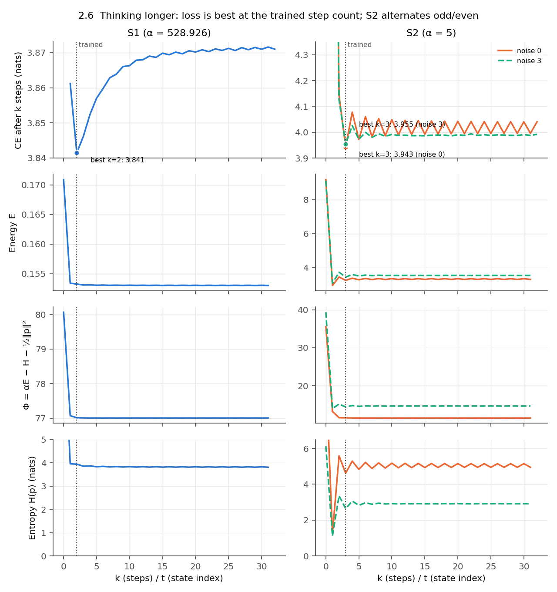
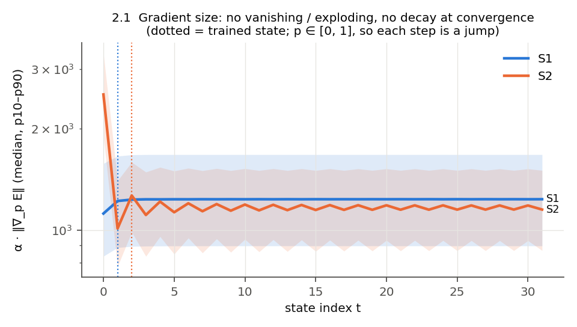
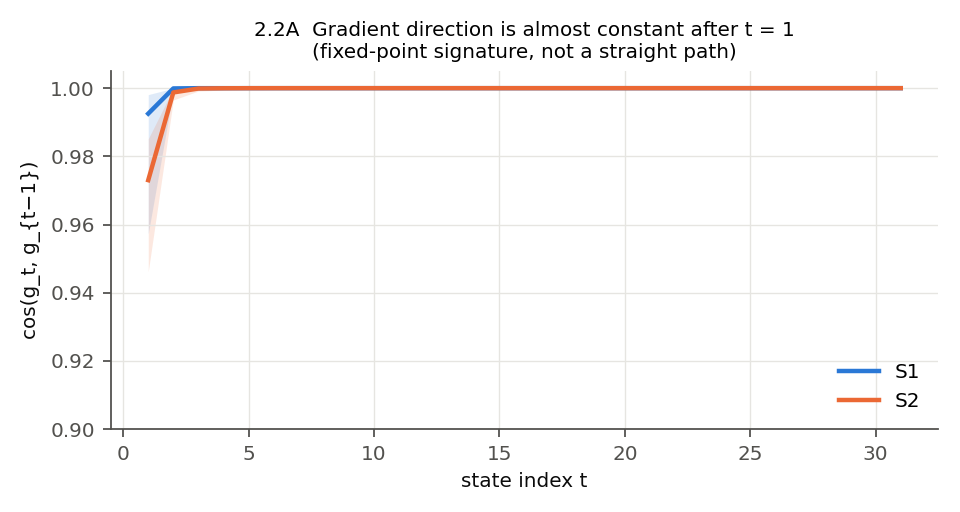
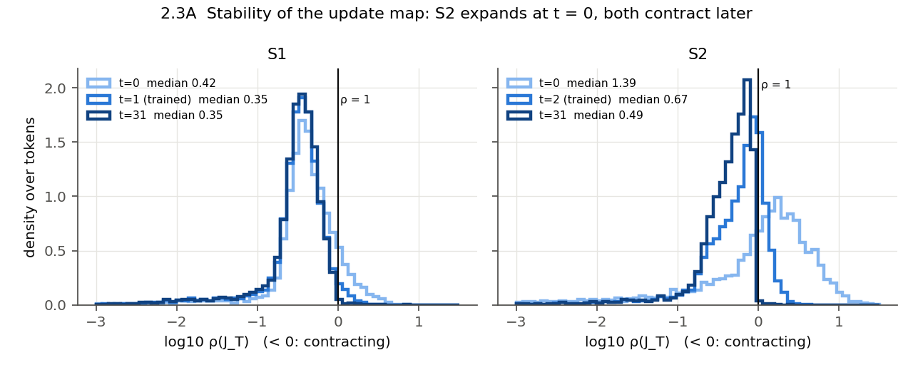
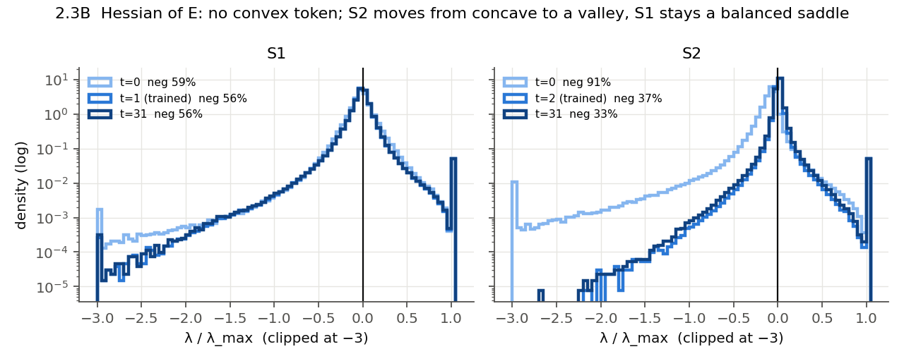
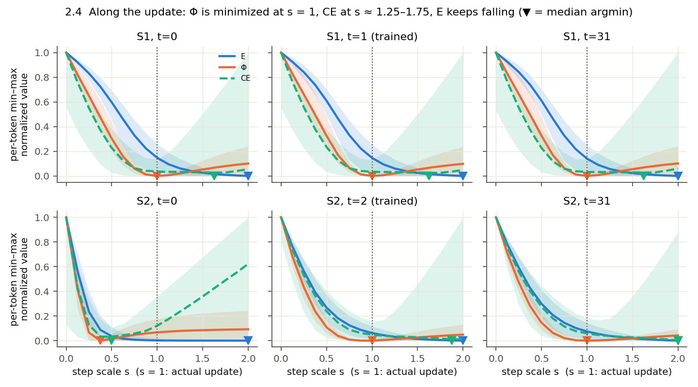
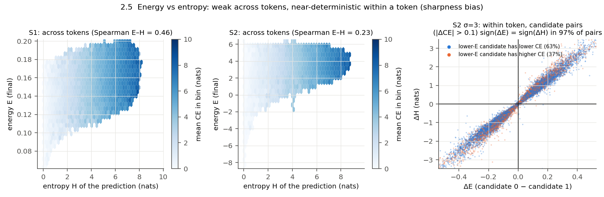

# Q3 — Energy landscape and update-map properties

> [!summary] TL;DR
> - EBT inference **as implemented in the public code** is a **fixed-point iteration** p ← softmax(p − α∇_pE(p)), whose fixed points are the stationary points of Φ(p) = α·E(p) − H(p) − ½‖p‖², not plain GD on E. This differs from the paper's own pseudocode, which takes the gradient with respect to the logits and accumulates them (§2.1). The measurements fit the code's rule: along the update direction, the step α is exactly the line-minimizer of Φ (median s* = 1.0 for both models and all states), while E keeps decreasing past it.
> - The loop **converges fast and contracts locally** (spectral radius of the update Jacobian at step 32: median 0.49 for S2, 0.35 for S1; >99% of tokens below 1), but **extra steps do not help loss**: the best CE is at the trained step count (S2: 3.943 at k=3 → 4.041 at k=32; S1: 3.841 at k=2 → 3.871). E itself is **non-convex** in the predicted embedding: 0% of tokens are locally convex, and 33–56% of the Hessian eigenvalues are negative.
> - Implications for a training-time optimizer swap: updates live in a **~20–30-dimensional effective subspace** (participation ratio of ∇_eE out of D = 384), gradients across steps are almost collinear (cos ≈ 0.998–1.0), and the curvature is very anisotropic (λ_max/median|λ| ≈ 13–75). These point to preconditioning or low-dimensional search as plausible levers, and away from momentum. Energy decrease is only weakly aligned with loss decrease (Spearman 0.4 for S2, ≈0 for S1 after step 2).

## 1. Setup

- Checkpoints: S2 and S1 at step 105k (see [[THINKING_STUDY_PLAN]] §2). Correctness gate passed (`../common/results/gate.json`).
- **Part A:** 256 validation sequences (55,825 target tokens), 32 MCMC steps, Langevin noise 0 for both models, plus noise 3 for S2 (its training value). One initial-noise draw per token.
- **Part B:** 32 sequences (6,949 tokens), noise 0, at three states: the initial noise (t = 0), the last trained step (S2 t = 2, S1 t = 1), and t = 31.
  - Exact per-token Hessian of E with respect to the predicted embedding e = W_v p (384 × 384, via 384 Hessian–vector products; tokens are independent, gate check 3).
  - Spectral radius ρ of the Jacobian of the update map T, by 30-step power iteration (Gelfand estimate).
  - Line profile q(s) = softmax(p − s·α·∇_pE) for s ∈ [0, 2], where s = 1 is the actual update.
- Code: `run_q3.py`, `analyze_q3.py`. Raw arrays: `results/<model>_step105000/*.npz` (not in git); metrics: `results/*/metrics.json`.

## 2. Mechanism: what the loop optimizes

From `model/nlp/ebt.py:115-175` (public code; the paper's pseudocode differs, §2.1), the gradient is taken with respect to the probabilities p = softmax(z), and the state is overwritten with z_{t+1} = p_t − α∇_pE(p_t). Setting the Lagrangian gradient of Φ on the simplex to zero gives α∇_pE + log p + 1 − p = const, i.e. p = softmax(p − α∇_pE(p)). So:

- the fixed points of the loop are the stationary points of Φ, an energy with an entropy regularizer at temperature 1/α (S1: α = 528.9, S2: α = 5). α alone does not set how strong the entropy term is, because the model learns the scale of E (mean energy ≈ 0.15 for S1, ≈ 3 for S2), so the two values are not directly comparable;
- the previous state carries over only through p ∈ [0, 1], so the loop has little memory, and every update lies in the row space of W_v (≤ 384 dims).

Empirical check: along the actual update direction, the median line-minimizer of Φ is **s = 1.0 at every measured state of both models**, while the minimizer of E is s = 2.0 (the edge of the scanned range; E is still decreasing). The update is a line-optimal step on Φ, not on E.

### 2.1 Paper pseudocode vs public code

The paper and the public code describe different update rules.

| | Paper (App. I.2, Listing 1) | Public code (`model/nlp/ebt.py`) |
|---|---|---|
| Softmax | Applied inline: `vocab_to_embed(softmax(predicted_distributions))` | `predicted_tokens` is overwritten with `softmax(predicted_tokens)` (l. 130/132) |
| Gradient taken w.r.t. | Logits z (`predicted_distributions`) | Probabilities p (the overwritten tensor; l. 149–153) |
| Update | z_{t+1} = z_t − α∇_zE(softmax(z_t)) | z_{t+1} = p_t − α∇_pE(p_t) (l. 171) |
| State carried to the next step | Accumulated logits z_t (unbounded) | p_t ∈ [0, 1] only |
| Fixed points are stationary points of | E∘softmax (no entropy term) | Φ = αE − H − ½‖p‖² |

```python
# Paper, Listing 1 (abridged)
predicted_embeddings = self.vocab_to_embed(softmax(predicted_distributions))
grad = torch.autograd.grad(predicted_energies.sum(), predicted_distributions, create_graph=True)[0]
predicted_distributions = predicted_distributions - self.alpha * grad

# Public code (abridged; normalize_initial_condition=True, as in our S1/S2 runs)
predicted_tokens = self.softmax(predicted_tokens)
grad = torch.autograd.grad([energy_preds.sum()], [predicted_tokens], ...)[0]
predicted_tokens = predicted_tokens - alpha * grad
```

- The two gradients are related by the softmax Jacobian: ∇_zE = p ⊙ (∇_pE − ⟨p, ∇_pE⟩). So the paper's rule also damps low-probability tokens and vanishes as p saturates; the code's rule does neither.
- The code's behaviour is in the authors' first public commit (`4aacd9e`, "add all code") and unchanged in the latest one we have (`19420cb`). It is not a change from our reproduction. No flag reproduces the paper's rule: disabling `normalize_initial_condition` removes the softmax entirely, which App. I.1.5 reports as unstable.
- We cannot tell whether this is intended. The code comment at l. 171 ("tokens will be unnormalize prob dist convert to prob dist after") treats the updated tensor as an unnormalized distribution; the paper does not mention it.
- The paper's results were presumably produced with this code, so they likely reflect the code's rule. This is an inference, not stated in the paper.
- **Scope of this report:** every mechanism claim here (Φ, the hidden entropy term, short memory) applies to the code's rule. A model trained with the paper's rule would optimize E∘softmax and keep memory through z. The two rules are a natural training-time ablation (see [[THINKING_STUDY_PLAN]] M4).

## 3. Results

### 3.1 Thinking longer (Part A, noise 0)

Mean CE of the prediction after k steps:

| k | 1 | 2 | 3 | 4 | 5 | 6 | 8 | 16 | 32 |
|---|---|---|---|---|---|---|---|---|---|
| S2 (α = 5) | 6.282 | 4.143 | **3.943** | 4.078 | 3.972 | 4.060 | 4.053 | 4.044 | 4.041 |
| S2, noise 3 | 6.179 | 4.125 | **3.955** | 4.026 | 3.973 | 4.000 | 3.994 | 3.989 | 3.992 |
| S1 (α = 528.9) | 3.861 | **3.841** | 3.846 | 3.852 | 3.857 | 3.860 | 3.864 | 3.869 | 3.871 |

- Both models are best at exactly the step count they were trained and validated with. Beyond it, CE rises and plateaus: +0.098 nats for S2 and +0.030 for S1 at k = 32.
- S2 oscillates for a few steps (k = 3, 4, 5, 6: 3.943, 4.078, 3.972, 4.060), and so does the mean entropy of p_t (1.23 → 5.59 → 4.62 → 5.29 at t = 1–4). This is consistent with ρ > 1 at the start (§3.3).
- S2 with noise 3 has no fixed point: the change between consecutive predictions stays at TV ≈ 0.89 per step, and only 4.6% of tokens settle within 32 steps.

### 3.2 Convergence and per-token adaptivity

| | S2, noise 0 | S2, noise 3 | S1, noise 0 |
|---|---|---|---|
| Median steps until TV(p_{t+1}, p_t) < 0.01 | 7 | 32 (not converged) | 3 |
| Converged by the trained step count | 6.4% | 1.4% | 3.5% |
| Converged within 32 steps | 82.6% | 4.6% | 96.9% |
| Spearman(steps to converge, entropy) | 0.81 | 0.33 | 0.18 |
| Spearman(steps to converge, CE) | 0.51 | 0.35 | 0.20 |
| Spearman(energy, CE) across tokens, at trained steps | 0.23 | 0.12 | 0.36 |

- **Facet 1 (adaptive compute) holds for S2 without noise:** high-entropy, hard tokens take longer to converge (ρ_s = 0.81 with entropy). It is much weaker for S1.
- Nearly no token has converged at the trained step count, yet stopping there gives the lowest loss. Convergence of the loop and quality of the prediction are different targets.

### 3.3 Local geometry (Part B)

| | S2 t=0 | S2 t=2 (trained) | S2 t=31 | S1 t=0 | S1 t=1 (trained) | S1 t=31 |
|---|---|---|---|---|---|---|
| Median λ_min of ∇²_eE | −7.37 | −1.36 | −1.25 | −0.038 | −0.045 | −0.045 |
| Median λ_max | 4.40 | 4.79 | 3.38 | 0.044 | 0.051 | 0.050 |
| Share of negative eigenvalues | 91% | 37% | 33% | 59% | 56% | 56% |
| Tokens locally convex | 0% | 0% | 0% | 0% | 0% | 0% |
| λ_max / median \|λ\| | 13 | 75 | 56 | 17 | 21 | 21 |
| Median ρ(Jacobian of T) | 1.39 | 0.67 | 0.49 | 0.42 | 0.35 | 0.35 |
| Share contracting (ρ < 1) | 39% | 79% | 99.7% | 88% | 97% | 99.4% |
| Participation ratio of ∇_eE (of 384) | 29.8 | 20.1 | 20.5 | 30.2 | 28.7 | 28.6 |
| Share of ‖g_p‖² in top 1% of vocab | 10% | 9% | 9% | 18% | 20% | 20% |
| Kurtosis of g_p (Gaussian = 3) | 4.5 | 3.9 | 3.9 | 8.6 | 10.7 | 11.0 |
| Line argmin s: CE / E / Φ | 0.5 / 2.0 / 0.375 | 1.6 / 2.0 / **1.0** | 1.75 / 2.0 / **1.0** | 1.25 / 2.0 / **1.0** | 1.25 / 2.0 / **1.0** | 1.25 / 2.0 / **1.0** |

- **E is a saddle-rich, non-convex function** of the predicted embedding: there are no locally convex tokens at any state. The loop still contracts because the entropy term in Φ is strongly convex. E's Hessian is not the Hessian of the map, and ρ < 1 is what matters for convergence.
- **The curvature is very anisotropic:** a few large eigenvalues against a near-zero bulk.
- **The effective dimension is small:** the per-token energy gradients use about 20 (S2) to 29 (S1) of the 384 available dimensions.
- **Energy and loss disagree on the step size:** along the update, CE is minimized at s ≈ 1.25 (S1) and 1.6–1.75 (S2), E keeps falling to s = 2, and Φ is minimized at s = 1.
- **Alignment along the trajectory:**
  - In 17% (S2) and 25% (S1) of the steps, energy decreases while CE increases.
  - Per step, Spearman(ΔE, ΔCE) is about 0.4 for S2, but falls to ≈0 for S1 after step 2 (0.55 → 0.14 → 0.07 → 0.0).
  - Once S1 is past its trained steps, lowering energy carries no information about the loss.
- **Successive gradients are almost collinear:** cos(g_t, g_{t−1}) ≈ 0.97 at step 1 and 0.998–1.0 afterwards, for both models.

### 3.4 Gradient magnitude, critical points, sharpness and smoothness (offline re-analysis)

Computed from the saved Part A / Part B arrays by `analyze_q3_extra.py` (no new forward passes) → `results/*/metrics_extra.json`. ‖g_p‖ is the centered gradient with respect to p (Part A, 55,825 tokens). Eigenvalues are of ∇²_eE (Part B, 6,949 tokens). "Trained state" = S2 t = 2, S1 t = 1.

**Gradient magnitude: no vanishing, no exploding, and no decay at convergence.**

| | S2 t=0 | S2 trained | S2 t=31 | S1 t=0 | S1 trained | S1 t=31 |
|---|---|---|---|---|---|---|
| Median ‖g_p‖ | 504 | 253 | 230 | 2.12 | 2.31 | 2.33 |
| p99 / p1 of ‖g_p‖ | 3.1 | 2.9 | 3.5 | 3.7 | 3.2 | 3.2 |

- The spread across tokens is narrow (p99/p1 ≈ 3) and stable over steps. The median ratio ‖g_p‖ at t = 31 / trained state is 0.94 (S2) and 1.01 (S1); no token drops by more than 10×.
- **The states the loop reaches are not stationary points of E.** The energy gradient is as large at t = 31 as at the trained state. This is consistent with §2: at a fixed point, α∇_pE is balanced by the entropy term of Φ, not driven to zero. Since g_p = W_vᵀ g_e, g_p ≠ 0 also implies ∇_eE ≠ 0. So none of these states is a local minimum or a saddle point of E in the strict sense.
- **Steps are large relative to the domain of p.** α · median ‖g_p‖ at the trained state is about 1,266 (S2) and 1,219 (S1), for p ∈ [0, 1]. The update is therefore close to softmax(−α g_p), a jump to the minimizer of the linearized objective rather than a small GD step. This explains the short memory of §2. The two models differ by about 100× in ‖g_p‖, but their α · ‖g_p‖ products are nearly equal: the learned energy scale compensates for α.
- Gradient size is not a difficulty signal: corr(log ‖g_p‖, final CE) = −0.34 (S2) and −0.23 (S1).

**Shape of the curvature at the visited states.**

| | S2 t=0 | S2 t=2 | S2 t=31 | S1 t=0 | S1 t=1 | S1 t=31 |
|---|---|---|---|---|---|---|
| Strong positive directions (λ > 0.1 λ_max), median | 9 | 7 | 11 | 49 | 29 | 30 |
| Strong negative directions (λ < −0.1 λ_max), median | 102 | 5 | 7 | 67 | 55 | 56 |
| Flat eigenvalues (\|λ\| < 1% of max\|λ\|), median share | 4% | 39% | 28% | 12% | 14% | 14% |
| Tokens with trace(H) < 0 | 99.8% | 6.9% | 4.5% | 79% | 84% | 81% |
| Tokens with \|λ_min\| > λ_max | 82% | 3.6% | 5.3% | 44% | 41% | 43% |
| α · median λ_max | 22 | 24 | 17 | 23 | 27 | 27 |

- **S2:** the initial-noise region is almost concave (trace < 0 for 99.8% of tokens, about 100 strong negative directions), which fits ρ > 1 at t = 0. After two steps the loop sits in a **valley-like region**: a handful of strong positive directions, a few strong negative ones, and a large flat bulk. It is close to convex in the directions that matter, but still saddle-shaped through many weak negative directions.
- **S1:** negative and positive curvature are balanced at every state (|λ_min| ≈ 0.9 λ_max, trace < 0 for about 80% of tokens). The shape barely changes from t = 0 to t = 31: S1's loop does not move into a differently shaped region.
- **Effective sharpness is the same for both models.** λ_max differs by about 100× (S2 4.79 vs S1 0.051 at the trained state), but α · λ_max is about 24 vs 27. This product is measured in e-coordinates; the update sees α W_vᵀ H W_v, so the comparison is indicative only. Because α · λ_max ≫ 2, plain GD on E would diverge along the stiff directions; the loop stays bounded through the softmax and the entropy term of Φ.
- Implication: an optimizer that only minimizes E (plain GD, Newton, search) would keep following the negative-curvature directions, and E keeps decreasing (line argmin of E at s = 2, the edge of the scan). Together with Q2 (lower energy ⇒ sharper distribution), this is a path to over-sharp, wrong predictions.

**Smoothness along the update direction** (s ∈ [0, 2], 17 points; roughness = max|Δ²E| / |E(2) − E(0)|):

| | S2 t=0 | S2 t=2 | S2 t=31 | S1 t=1 | S1 t=31 |
|---|---|---|---|---|---|
| Sign changes of dE/ds, median | 2 | 0 | 0 | 0 | 0 |
| Roughness of E, median | 0.21 | 0.068 | 0.058 | 0.037 | 0.039 |
| Tokens where E is convex along the line | 5.9% | 66% | 67% | 1.5% | 1.4% |
| Interior minima of CE along the line, median | 1 | 1 | 1 | 1 | 1 |

- After the first step, E is smooth and monotone along the update for most tokens. The noise region (S2 t = 0) is about 3× rougher.
- Along the line, S2's E is convex for two thirds of tokens, while S1's is almost always concave, so S1's energy falls faster toward the edge of the scan.
- CE is unimodal along the line, with one interior minimum (s ≈ 1.25–1.75, §3.3); E has none. In the tail (p99) the CE roughness reaches 1–7, so a few tokens react sharply to the step size, probably where p is saturated.

**Period-2 oscillation (limit cycle).** The tokens that do not converge in §3.2 mostly flip-flop with period 2 rather than drift.

| | S2, noise 0 | S1, noise 0 |
|---|---|---|
| Not converged at t = 31 (TV ≥ 0.01) | 17.7% | 3.2% |
| 2-cycle-like (\|logp₃₁ − logp₂₉\| < 0.1 · \|logp₃₁ − logp₃₀\|) | 16.2% | 2.9% |
| Share of the non-converged tokens that are 2-cycle-like | 92% | 89% |
| Median TV per step of 2-cycle tokens | 0.19 | 0.28 |
| Mean CE after k = 31 / k = 32 | 3.996 / 4.041 | 3.872 / 3.871 |

- For S2, the mean CE keeps alternating between odd and even k up to k = 32 (and so does the mean entropy, 4.95 ↔ 5.14), so odd step counts are always better. The best value, 3.943 at k = 3, is odd.
- Hypothesis, not tested: with α · λ_max ≈ 24, the update map has an eigenvalue near −1 for these tokens. This does not fully agree with the measured ρ at t = 31, which exceeds 1 for only 0.3% (S2) and 0.6% (S1) of tokens. Either the power-iteration estimate misses negative or complex dominant eigenvalues (see the Scope note), or the cycle is a non-linear effect.
- A cheap lever follows: damping the update, e.g. p ← ½(p + T(p)), would remove a pure 2-cycle. Its effect on CE is untested.
- Data cannot answer: whether E has true local minima elsewhere. That needs a separate experiment, e.g. plain GD on E from many initial points, classifying where it stops.

### 3.5 Figures

Drawn by `plot_q3.py` from the saved Q2/Q3 arrays; chart design in [[ENERGY_LANDSCAPE_VISUALIZATIONS]]. Median lines with p10–p90 bands unless stated.

**Thinking longer (§3.1).** CE is best at the trained step count; S2 without noise alternates odd/even up to k = 32 (2-cycle, §3.4); Φ is flat after two steps while E and entropy still move.



**Gradient size (§3.4).** α‖g_p‖ stays near 1.2k for both models and does not decay at convergence: the end points are not stationary points of E.



**Gradient direction (§3.3).** cos(g_t, g_{t−1}) ≈ 1 after t = 1. With an overwriting update this is a fixed-point signature, not evidence of a straight path.



**Stability of the update map (§3.3).** S2 expands at t = 0 (median ρ 1.39) and contracts later; S1 contracts from the start.



**Hessian spectrum (§3.3, §3.4).** S2 moves from mostly negative curvature (91%) to a valley shape (33–37% negative); S1 keeps a balanced saddle shape at every state.



**1D slices along the update (§2, §3.3).** Φ is minimized at s = 1; E keeps falling to s = 2. The CE band is wide for s > 1: a longer step helps some tokens and hurts many.



> [!note] Normalization
> Each curve is min–max normalized per token before the median is taken. The median-curve argmin of CE for S1 is ≈1.6, while the median of per-token argmins (table in §3.3) is 1.25. Both are correct; they summarize different things.

**Energy vs entropy (Q2 arrays).** Across tokens the link is moderate (Spearman E–H 0.46 for S1, 0.23 for S2). Within a token, sign(ΔE) = sign(ΔH) for 97% of candidate pairs (20k pairs of candidates 0 and 1, S2 σ = 3; Q2 reports 98% over all pairs), while correct and wrong rankings are mixed along the diagonal: the energy ranks by sharpness.



## 4. Implications for replacing plain GD in training (Gap 3)

These are hypotheses for a training-time study, ranked by how directly the data supports them. They are not results.

| Lever | Evidence here | Expected effect |
|---|---|---|
| **Low-dimensional search** (gradient-free or second-order in a ~20–30-dim subspace of the 384-dim row space of W_v) | Participation ratio 20–30; every update is in W_v's row space by construction | Makes CMA-ES or exact Newton steps per token affordable. Needs a non-unrolled training signal for gradient-free methods (§5 of the plan) |
| **Preconditioning** (Adam-like per-direction scaling, or a learned or Newton preconditioner) | λ_max/median\|λ\| ≈ 20–75; a few stiff directions | Could equalize progress across directions. Note the stiff directions are where E is convex; the bulk is flat or negative |
| **Step-size / temperature control** | Φ is line-minimized at s = 1 while CE prefers s ≈ 1.25–1.75; the trained step count beats more steps | The effective objective is Φ at temperature 1/α. Learning α per step or per token (S1 already learns a global α) is a cheaper lever than a new optimizer |
| **Momentum / Nesterov** | Gradients already collinear (cos ≈ 1) and the map contracts (ρ ≈ 0.35–0.5) | Little to gain for loss. It may speed fixed-point convergence, but convergence is not what limits loss here |
| **Stopping rule** | Steps to converge correlate with entropy (0.81 for S2) | Per-token adaptive compute is feasible for S2. It should stop near the trained step count, not at convergence |
| **Damping** (p ← ½(p + T(p))) | 92% of S2's non-converged tokens are in a 2-cycle; α · λ_max ≈ 24 (§3.4) | Would remove a pure period-2 oscillation without extra steps. Effect on CE untested |

> [!warning] Scope
> - Single checkpoint per model (105k), xxs, one seed. Part B uses 6,949 tokens.
> - These landscapes were co-trained with this specific update rule. A model trained with a different inner optimizer would learn a different landscape, so §4 states plausibility and mechanism only.
> - ρ is a 30-step power-iteration estimate. It can be inaccurate when the dominant eigenvalues are complex or nearly tied.

## 5. Reproduction

```bash
cd refs/EBT/experiments/thinking_study
GPU_ID=4 bash q3_energy_landscape/run_all.sh          # ~25 min on one H100 NVL
PYTHONPATH=$PWD/common /mnt/data/conda-envs/quangnx/ebt312/bin/python q3_energy_landscape/analyze_q3.py \
  q3_energy_landscape/results/s2_step105000 q3_energy_landscape/results/s1_step105000
# §3.4, offline from the saved arrays (seconds, CPU only) -> results/*/metrics_extra.json
PYTHONPATH=$PWD/common /mnt/data/conda-envs/quangnx/ebt312/bin/python q3_energy_landscape/analyze_q3_extra.py \
  q3_energy_landscape/results/s2_step105000 q3_energy_landscape/results/s1_step105000
# §3.5 figures (CPU, ~1 min) -> q3_energy_landscape/figures/*.png
/mnt/data/conda-envs/quangnx/ebt312/bin/python q3_energy_landscape/plot_q3.py
```
